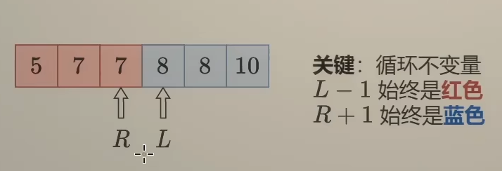
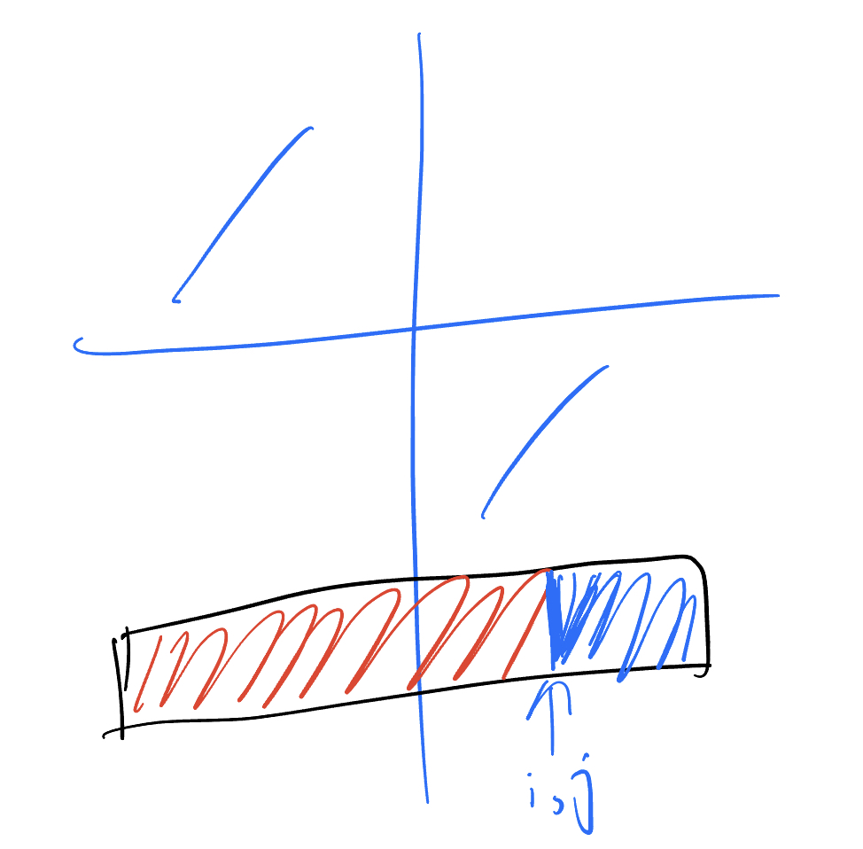
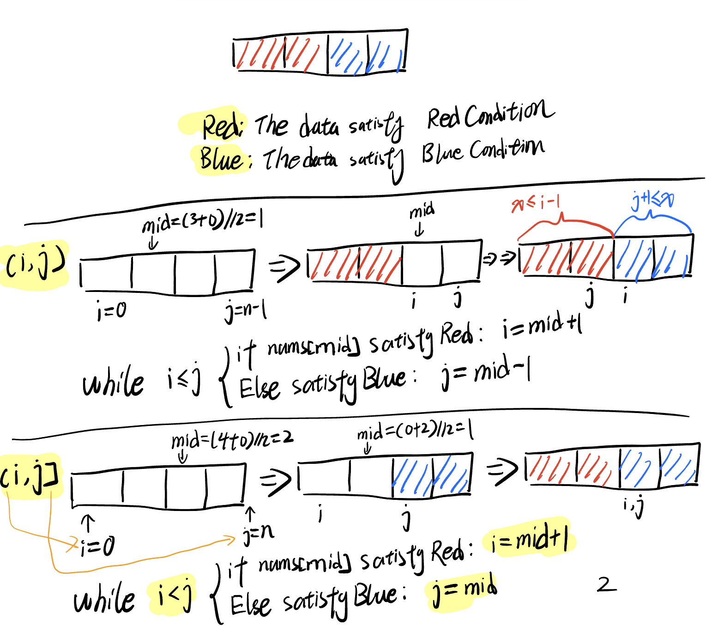
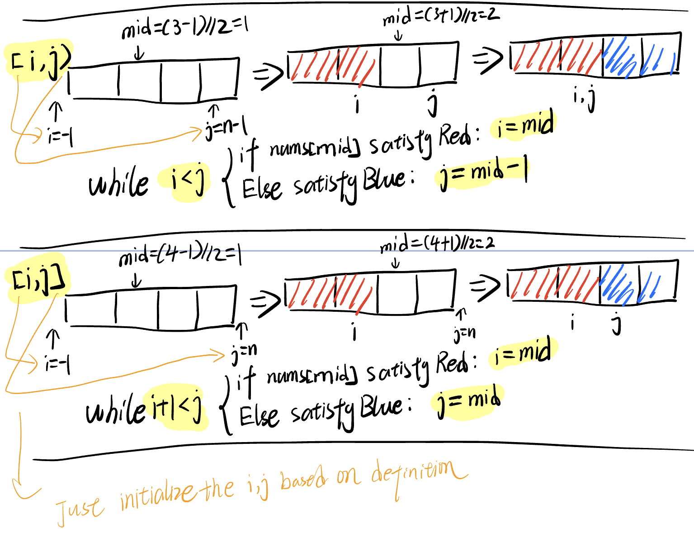

# 二分搜索 Binary Search 

## 思路

红蓝染色法：

1. right 左移使右侧变蓝 (判断条件为 true )
2. left 右移使左侧变红 (判断条件为 false )
3. 故确定二分处 ( mid ) 的染色条件是关键



## 模板

## bisect_left

`nums` 需按非递减顺序排列；返回第一个 `>= target` 的下标，不存在时返回 `len(nums)`。下面的区间均指尚未判断的下标。

开闭区间表示是否包含边界：方括号 `[`、`]` 表示包含，圆括号 `(`、`)` 表示不包含。对于整数下标：

| 写法 | 名称 | 下标 `k` 满足 | 以边界 1、4 为例，包含的下标 |
|---|---|---|---|
| `[i, j]` | 闭区间 | `i <= k <= j` | 1、2、3、4 |
| `[i, j)` | 左闭右开区间 | `i <= k < j` | 1、2、3 |
| `(i, j)` | 开区间 | `i < k < j` | 2、3 |

三个例子统一使用 `nums = [1, 2, 2, 4, 5]`、`target = 2`。`< target` 为红色，`>= target` 为蓝色，答案是第一个蓝色位置 `1`。

### [i, j] 闭区间

```python
# [i, j] -> i <= j; i = mid + 1, j = mid - 1
def bisect_left(nums, target):
    i = 0
    j = len(nums) - 1
    while i <= j:
        mid = (i+j) // 2
        if nums[mid] < target:
            i = mid + 1
        else:
            j = mid - 1
    return i
```

两端都包含在待判断区间中，判断完 `mid` 后用 `mid + 1` 或 `mid - 1` 排除它。结束时 `i > j`，返回 `i`。

| 轮次 | `i` | `j` | 待判断区间 | `mid` | 判断 | 更新 |
|---|---:|---:|---|---:|---|---|
| 1 | 0 | 4 | `[0, 4]` | 2 | `nums[2] = 2 >= 2`，蓝色 | `j = 1` |
| 2 | 0 | 1 | `[0, 1]` | 0 | `nums[0] = 1 < 2`，红色 | `i = 1` |
| 3 | 1 | 1 | `[1, 1]` | 1 | `nums[1] = 2 >= 2`，蓝色 | `j = 0` |
| 结束 | 1 | 0 | 空区间 | — | `i > j` | 返回 `i = 1` |


### [i, j) 半开区间

```python
# [i, j) -> i < j; i = mid + 1, j = mid
def bisect_left(nums, target):
    i = 0
    j = len(nums)  # 使用半开区间 [i, j)
    while i < j:
        mid = (i + j) // 2
        if nums[mid] < target:  # 注意这里是 < 而不是 <=
            i = mid + 1
        else:
            j = mid
    return i

for i in range(1, 10):
    print(i, bisect_left([1,2,3,4,5], i))
```

左端包含、右端不包含。`j = mid` 已将 `mid` 排除；初始 `j = len(nums)` 不会被访问。结束时 `i == j`，返回 `i`。

| 轮次 | `i` | `j` | 待判断区间 | `mid` | 判断 | 更新 |
|---|---:|---:|---|---:|---|---|
| 1 | 0 | 5 | `[0, 5)`，下标 0～4 | 2 | `nums[2] = 2 >= 2`，蓝色 | `j = 2` |
| 2 | 0 | 2 | `[0, 2)`，下标 0～1 | 1 | `nums[1] = 2 >= 2`，蓝色 | `j = 1` |
| 3 | 0 | 1 | `[0, 1)`，只有下标 0 | 0 | `nums[0] = 1 < 2`，红色 | `i = 1` |
| 结束 | 1 | 1 | 空区间 | — | `i == j` | 返回 `i = 1` |


### (i, j) 开区间

```python
# (i, j) -> i + 1 < j; i = mid, j = mid
def bisect_left(nums, target):
    i = -1
    j = len(nums)
    while i + 1 < j:
        mid = (i+j) // 2
        if nums[mid] < target:
            i = mid
        else:
            j = mid
    return i + 1 # j
```

两端都不包含。`i` 是已知红色边界，`j` 是已知蓝色边界；初始 `-1` 和 `len(nums)` 是虚拟边界，不会被访问。结束时两端相邻，返回 `i + 1`，也就是 `j`。

| 轮次 | `i` | `j` | 待判断区间 | `mid` | 判断 | 更新 |
|---|---:|---:|---|---:|---|---|
| 1 | -1 | 5 | `(-1, 5)`，下标 0～4 | 2 | `nums[2] = 2 >= 2`，蓝色 | `j = 2` |
| 2 | -1 | 2 | `(-1, 2)`，下标 0～1 | 0 | `nums[0] = 1 < 2`，红色 | `i = 0` |
| 3 | 0 | 2 | `(0, 2)`，只有下标 1 | 1 | `nums[1] = 2 >= 2`，蓝色 | `j = 1` |
| 结束 | 0 | 1 | 空区间 | — | `i + 1 == j` | 返回 `j = i + 1 = 1` |


### 三种写法的边界含义

这里 `n = len(nums)`；颜色描述的是下标对应的元素。

| 待判断区间 | 左边界 `i` 的含义 | 右边界 `j` 的含义 |
|---|---|---|
| `[i, j]` | 尚未判断 | 尚未判断 |
| `[i, j)` | 尚未判断 | 已确定为蓝色，或虚拟边界 `n` |
| `(i, j)` | 已确定为红色，或虚拟边界 `-1` | 已确定为蓝色，或虚拟边界 `n` |

表中的“尚未判断”适用于区间非空时；结束时区间已空。开闭只说明边界是否属于待判断区间，边界的颜色则由这三段代码的更新规则保证。

## 162. 寻找峰值 / Find Peak Element

[LeetCode 中文站](https://leetcode.cn/problems/find-peak-element/) · [LeetCode 国际站](https://leetcode.com/problems/find-peak-element/)

**简要题意：** 数组相邻元素不相等，两端外侧视为负无穷，返回任意一个严格大于相邻元素的峰值下标，要求对数时间复杂度。

```python
class Solution:
    def findPeakElement(self, nums: List[int]) -> int:
        # we use [left, right) left closed and right open interval
        # red blue painting approach to solve this problem
        left = 0
        right = len(nums) - 1
        while left < right:
            mid = (left + right) // 2
            if nums[mid] < nums[mid+1]:
                left = mid + 1
            else:
                right = mid
        return left
```

## 34. 在排序数组中查找元素的第一个和最后一个位置 / Find First and Last Position of Element in Sorted Array

[LeetCode 中文站](https://leetcode.cn/problems/find-first-and-last-position-of-element-in-sorted-array/) · [LeetCode 国际站](https://leetcode.com/problems/find-first-and-last-position-of-element-in-sorted-array/)

**简要题意：** `nums` 按非递减顺序排列。返回 target 的首次与末次出现下标；不存在则返回 `[-1,-1]`。要求 O(log n) 时间。

```python
class Solution:
    def searchRange(self, nums: List[int], target: int) -> List[int]:
        if len(nums) == 0:
            return [-1, -1]
        def lowBound(nums, target):
            # we use left open and right open interval here
            left = -1
            right = len(nums)
            while left + 1 < right:
                mid = (left + right) // 2
                if nums[mid] >= target:
                    right = mid
                else:
                    left = mid
            return left
        left = lowBound(nums, target) + 1 # plus 1 to make it ranges from [0, len(nums)]
        right = lowBound(nums, target+1)
        if left == len(nums) or nums[left] != target: # left is after the end, or left is not equal to the target
            return [-1, -1]
        else:
            return [left, right]
```

## 153. 寻找旋转排序数组中的最小值 / Find Minimum in Rotated Sorted Array

[LeetCode 中文站](https://leetcode.cn/problems/find-minimum-in-rotated-sorted-array/) · [LeetCode 国际站](https://leetcode.com/problems/find-minimum-in-rotated-sorted-array/)

**简要题意：** 严格递增数组经过旋转，元素互不相同，找出最小值，要求对数时间复杂度。

```
class Solution:
    def findMin(self, nums: List[int]) -> int:
        def isBlue(mid):
            if nums[mid] > end:
                return False
            else:
                return True
        # left open right closed interval
        left = 0
        right = len(nums)
        end = nums[-1]
        while left < right:
            mid = (left + right) // 2
            if isBlue(mid):
                right = mid
            else:
                left = mid + 1
        return nums[right]
```

## 154. 寻找旋转排序数组中的最小值 II / Find Minimum in Rotated Sorted Array II

[LeetCode 中文站](https://leetcode.cn/problems/find-minimum-in-rotated-sorted-array-ii/) · [LeetCode 国际站](https://leetcode.com/problems/find-minimum-in-rotated-sorted-array-ii/)

**简要题意：** 非递减数组经过旋转，元素可能重复，找出数组中的最小值。

```
class Solution:
    def findMin(self, nums: List[int]) -> int:
        end = nums[-1]
        i = 0
        while i < len(nums) and nums[i] == end: # 跳过开头的重复数字，来避免[3,1,3], right变成0
            i+=1
        if i == len(nums): # 如果全部一样则直接返回结果
            return end
        nums = nums[i:] #跳过重复数字

        def isBlue(mid):
            if nums[mid] <= end:
                return True
            else:
                return False
        # left closed right open interval
        left = 0
        right = len(nums)
        while left < right:
            mid = (left + right) // 2
            if isBlue(mid):
                right = mid
            else:
                left = mid + 1
        return nums[right]
```

## 33. 搜索旋转排序数组 / Search in Rotated Sorted Array

[LeetCode 中文站](https://leetcode.cn/problems/search-in-rotated-sorted-array/) · [LeetCode 国际站](https://leetcode.com/problems/search-in-rotated-sorted-array/)

**简要题意：** 严格递增数组在某个位置旋转后得到 `nums`。返回 target 在当前数组中的下标；不存在时返回 -1。要求 O(log n) 时间。



```
class Solution:
    def search(self, nums: List[int], target: int) -> int:
        end = nums[-1]
        def isBlue(mid):
            if nums[mid] > end:
                return target <= nums[mid] and target > end #target在mid的左边大于end的那段递增线段
            else:
                return target <= nums[mid] or target > end #target在最小和mid的中间，或者在左边大于end的递增线段
        left = 0
        right = len(nums) - 1
        while left < right:
            mid = (left+right) //2
            if isBlue(mid):
                right = mid
            else:
                left = mid + 1
        if nums[right] != target:
            return -1
        return right
```

## 2529. 正整数和负整数的最大计数 / Maximum Count of Positive Integer and Negative Integer

[LeetCode 中文站](https://leetcode.cn/problems/maximum-count-of-positive-integer-and-negative-integer/) · [LeetCode 国际站](https://leetcode.com/problems/maximum-count-of-positive-integer-and-negative-integer/)

**简要题意：** 给定非递减整数数组，分别统计正数和负数个数，返回两者的较大值，0 不计入任一类。

```
class Solution:
    def maximumCount(self, nums: List[int]) -> int:
        left = 0
        right = len(nums) - 1
        while left < right:
            mid = (left + right) //2
            if nums[mid] >= 0:
                right = mid -1
            else:
                left = mid
        neg = left+1
        pos = left
        while left < len(nums) and nums[left] <=0:
            left+=1
        pos = len(nums) - 1 - left
        return max(neg, pos)
```

## 其他区间写法对照

### 开区间 `(i, j)` 与闭区间 `[i, j]`



### 半开区间 `[i, j)` 与闭区间 `[i, j]`



开区间指的是区间边界的两个值不包括在内，格式为：

```
(a, b)
a < x < b
```

闭区间指的是区间边界的两个值包括在内，格式为：

```
[a,b]
a <= x <=b
```
