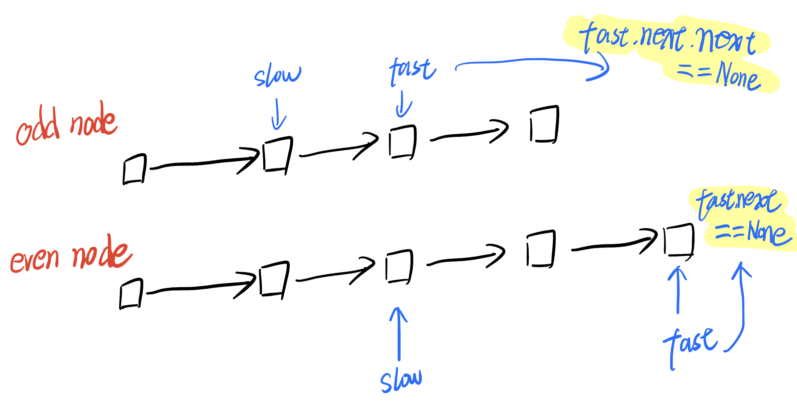
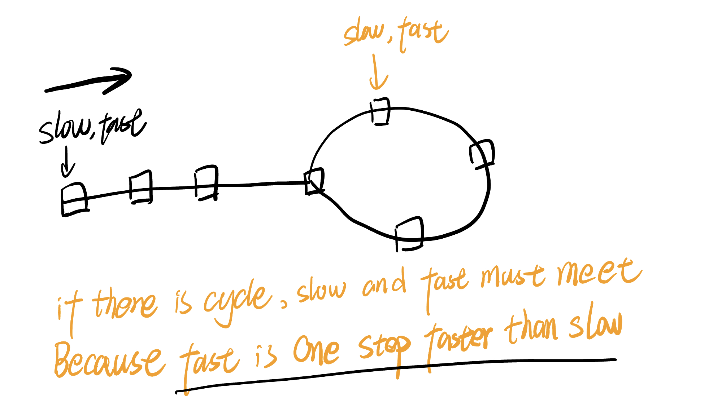
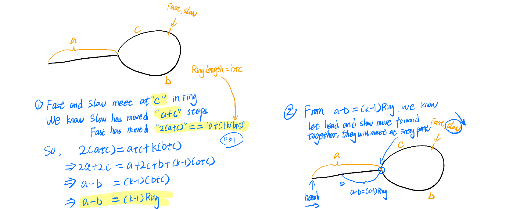

# 链表快慢指针系列 Linked List Fast Slow Series

## 思路

### 寻找链表中点



### 判断链表是否有环

快慢指针能否判断链表中存在环？

- 有环：慢指针 `SLOW` 每次走一步，快指针 `FAST` 每次走两步；进入环后，快指针每轮相对多走一步，最终必定相遇。
- 无环：链表有终点，快指针最终会到达空结点，无法一直向前移动。



### 寻找环的入口



## 模板：寻找环的入口

```python
class Solution:
    def detectCycle(self, head: Optional[ListNode]) -> Optional[ListNode]:
        fast = head
        slow = head
        while fast and fast.next:
            fast = fast.next.next
            slow = slow.next
            if fast == slow:
                while head != slow:
                    slow = slow.next
                    head = head.next
                return head
        return None
```

## 876. 链表的中间结点 / Middle of the Linked List

[LeetCode 中文站](https://leetcode.cn/problems/middle-of-the-linked-list/) · [LeetCode 国际站](https://leetcode.com/problems/middle-of-the-linked-list/)

**简要题意：** 返回单链表的中间节点；节点数为偶数时，返回两个中间节点中的后一个。

```python
# Definition for singly-linked list.
# class ListNode:
#     def __init__(self, val=0, next=None):
#         self.val = val
#         self.next = next
class Solution:
    def middleNode(self, head: Optional[ListNode]) -> Optional[ListNode]:
        slow = head
        fast = head
        while fast and fast.next:
            fast = fast.next.next
            slow = slow.next
        return slow
```

```go
/**
 * Definition for singly-linked list.
 * type ListNode struct {
 *     Val int
 *     Next *ListNode
 * }
 */
func middleNode(head *ListNode) *ListNode {
    slow := head
    fast := head
    for fast != nil && fast.Next != nil {
        fast = fast.Next.Next
        slow = slow.Next
    }
    return slow
}
```

## 141. 环形链表 / Linked List Cycle

[LeetCode 中文站](https://leetcode.cn/problems/linked-list-cycle/) · [LeetCode 国际站](https://leetcode.com/problems/linked-list-cycle/)

**简要题意：** 判断单链表是否存在环，即能否沿 next 指针再次到达之前访问过的节点；要求不修改链表。

```
/**
 * Definition for singly-linked list.
 * type ListNode struct {
 *     Val int
 *     Next *ListNode
 * }
 */
func hasCycle(head *ListNode) bool {
    slow := head
    fast := head
    for fast != nil && fast.Next != nil {
        fast =  fast.Next.Next
        slow = slow.Next
        if slow == fast {
            return true
        }
    }
    return false
}
```

## 142. 环形链表 II / Linked List Cycle II：寻找环的入口

[LeetCode 中文站](https://leetcode.cn/problems/linked-list-cycle-ii/) · [LeetCode 国际站](https://leetcode.com/problems/linked-list-cycle-ii/)

**简要题意：** 若链表有环，返回环的入口节点，否则返回空；不能修改链表。

Python

```python
class Solution:
    def detectCycle(self, head: Optional[ListNode]) -> Optional[ListNode]:
        fast = head
        slow = head
        while fast and fast.next:
            fast = fast.next.next
            slow = slow.next
            if fast == slow:
                while head != slow:
                    slow = slow.next
                    head = head.next
                return head
        return None
```

Go

```go
/**
 * Definition for singly-linked list.
 * type ListNode struct {
 *     Val int
 *     Next *ListNode
 * }
 */
func detectCycle(head *ListNode) *ListNode {
    slow := head
    fast := head
    for fast != nil && fast.Next != nil {
        fast =  fast.Next.Next
        slow = slow.Next
        if slow == fast {
            for head != nil && slow != nil {
                if slow == head {
                    return head
                }
                slow = slow.Next
                head = head.Next
            }
            return nil
        }
    }
    return nil
}
```

## 参考资料

1. [灵神视频](https://www.bilibili.com/video/BV1KG4y1G7cu/?vd_source=66a0b89065d7f04805223fd7f2d613a6)
