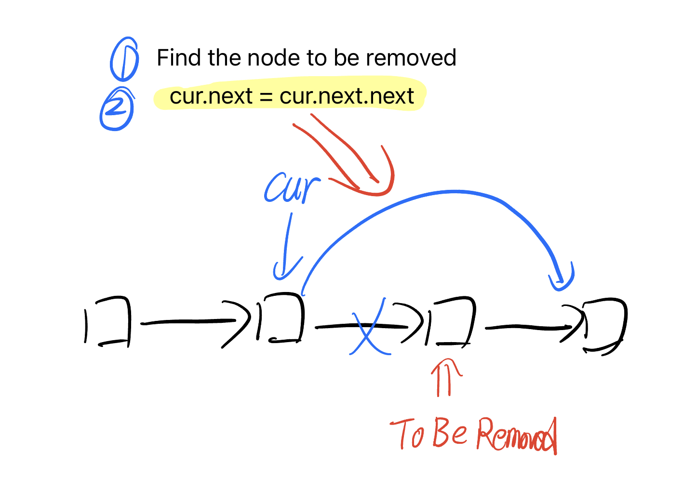
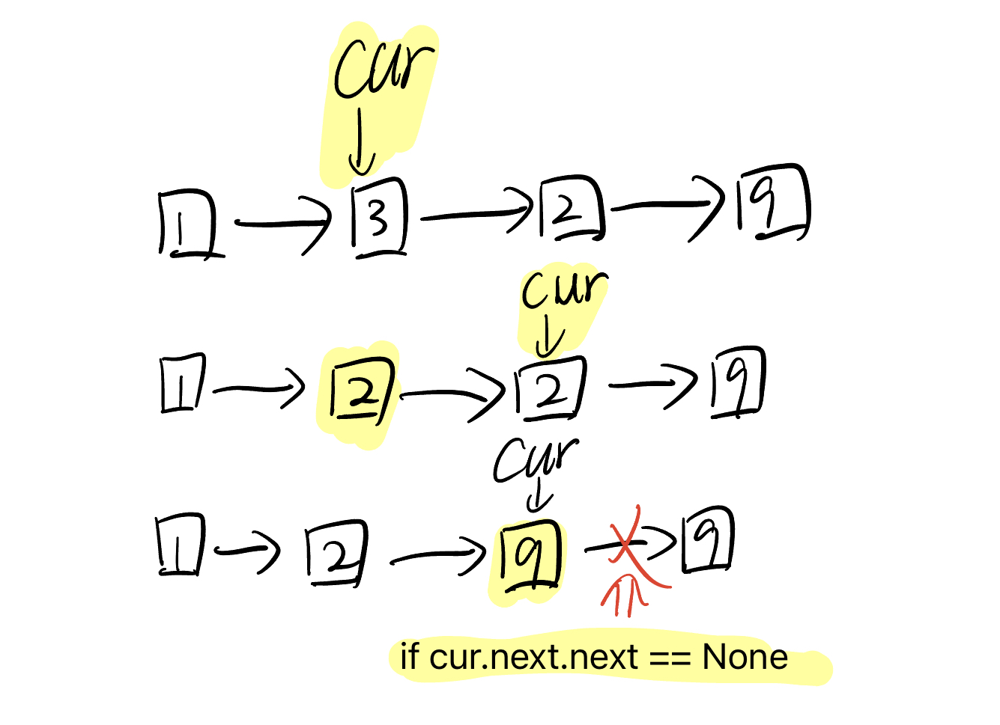
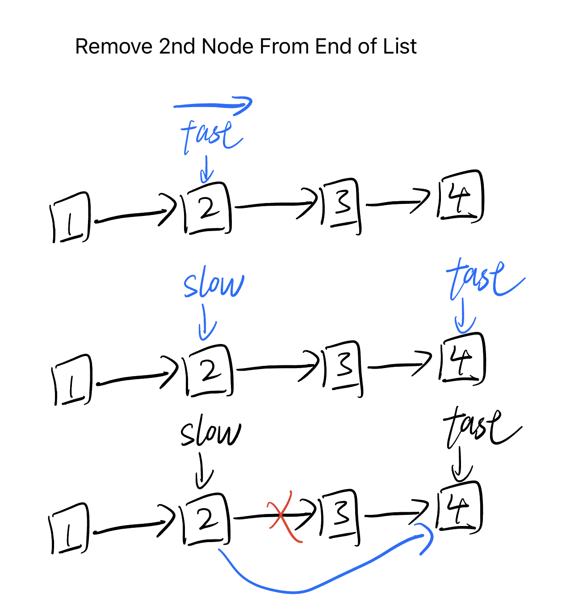
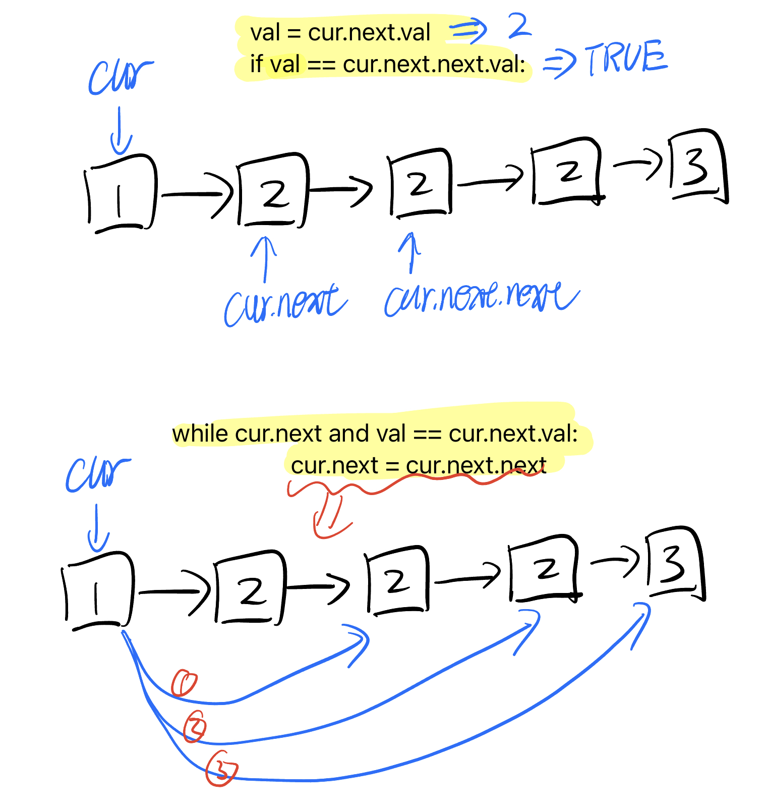

# 链表删除系列 Linked List Delete Series

## 思路

- 找到待删除结点的前驱结点 `cur`。
- `cur.next = cur.next.next`



## 237. 删除链表中的节点 / Delete Node in a Linked List

[LeetCode 中文站](https://leetcode.cn/problems/delete-node-in-a-linked-list/) · [LeetCode 国际站](https://leetcode.com/problems/delete-node-in-a-linked-list/)

**简要题意：** 只给出单链表中待删除的节点，且该节点不是尾节点，在无法访问头节点的情况下删除它。



```python
# Definition for singly-linked list.
# class ListNode:
#     def __init__(self, x):
#         self.val = x
#         self.next = None

class Solution:
    def deleteNode(self, node):
        """
        :type node: ListNode
        :rtype: void Do not return anything, modify node in-place instead.
        """
        cur = node
        while cur and cur.next:
            cur.val = cur.next.val
            if cur.next.next == None:
                cur.next = None
            else:
                cur = cur.next
```

## 19. 删除链表的倒数第 N 个结点 / Remove Nth Node From End of List

[LeetCode 中文站](https://leetcode.cn/problems/remove-nth-node-from-end-of-list/) · [LeetCode 国际站](https://leetcode.com/problems/remove-nth-node-from-end-of-list/)

**简要题意：** 删除单链表的倒数第 n 个结点，返回新头节点。n 从 1 开始；保证 n 不超过结点数量。



```python
# Definition for singly-linked list.
# class ListNode:
#     def __init__(self, val=0, next=None):
#         self.val = val
#         self.next = next
class Solution:
    def removeNthFromEnd(self, head: Optional[ListNode], n: int) -> Optional[ListNode]:
        dummy = ListNode(next=head)
        slow = dummy
        fast = dummy
        for i in range(n):
            fast = fast.next
        while fast.next:
            slow = slow.next
            fast = fast.next
        slow.next = slow.next.next
        return dummy.next
```

## 83. 删除排序链表中的重复元素 / Remove Duplicates from Sorted List

[LeetCode 中文站](https://leetcode.cn/problems/remove-duplicates-from-sorted-list/) · [LeetCode 国际站](https://leetcode.com/problems/remove-duplicates-from-sorted-list/)

**简要题意：** 给定有序链表，删除重复节点，使每个不同的值只保留一个节点。

```python
# Definition for singly-linked list.
# class ListNode:
#     def __init__(self, val=0, next=None):
#         self.val = val
#         self.next = next
class Solution:
    def deleteDuplicates(self, head: Optional[ListNode]) -> Optional[ListNode]:
        dummy = ListNode(next=head)
        cur = dummy.next
        while cur and cur.next:
            if cur.val == cur.next.val:
                cur.next = cur.next.next
            else:
                cur = cur.next
        return head
```

## 82. 删除排序链表中的重复元素 II / Remove Duplicates from Sorted List II

[LeetCode 中文站](https://leetcode.cn/problems/remove-duplicates-from-sorted-list-ii/) · [LeetCode 国际站](https://leetcode.com/problems/remove-duplicates-from-sorted-list-ii/)

**简要题意：** 给定有序链表，删除所有出现重复值的节点，只保留原本仅出现一次的值。



```python
# Definition for singly-linked list.
# class ListNode:
#     def __init__(self, val=0, next=None):
#         self.val = val
#         self.next = next
class Solution:
    def deleteDuplicates(self, head: Optional[ListNode]) -> Optional[ListNode]:
        dummy = ListNode(next=head)
        cur = dummy
        while cur.next and cur.next.next:
            val = cur.next.val
            if val == cur.next.next.val:
                while cur.next and val == cur.next.val:
                    cur.next = cur.next.next
            else:
                cur = cur.next
        return dummy.next
```

## 参考资料

1. [灵神视频，删除链表重复节点 基础算法精讲 08](https://www.bilibili.com/video/BV1VP4y1Q71e/?share_source=copy_web&vd_source=5d4accef9045e3ed4e08bbb7a80f3c70)
