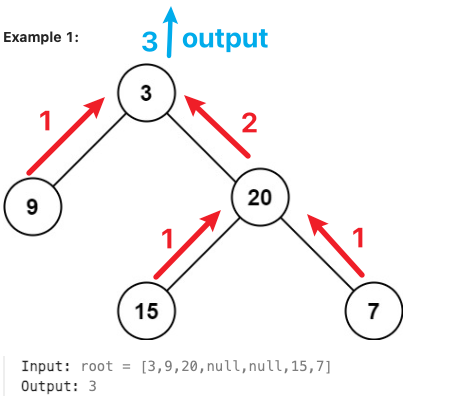

# 二叉树与递归，最大深度 Binary Tree and Recursion

## 思路

递归要回答三个问题：

1. 当前要求解什么问题？
2. 当前结点需要执行什么操作？
3. 接下来递归求解哪些子问题？



## 104. 二叉树的最大深度 / Maximum Depth of Binary Tree

[LeetCode 中文站](https://leetcode.cn/problems/maximum-depth-of-binary-tree/) · [LeetCode 国际站](https://leetcode.com/problems/maximum-depth-of-binary-tree/)

**简要题意：** 返回二叉树从根节点到最远叶节点路径上的节点数；空树深度为 0。

```
# Definition for a binary tree node.
# class TreeNode:
#     def __init__(self, val=0, left=None, right=None):
#         self.val = val
#         self.left = left
#         self.right = right
class Solution:
    def maxDepth(self, root: Optional[TreeNode]) -> int:
        if root == None:
            retunr 0
        leftDepth = maxDepth(root.left)
        rightDepth = maxDepth(root.right)
        return max(leftDepth, rightDepth) + 1
```

## 参考资料

1. [二叉树与递归 - 深入理解](https://www.bilibili.com/video/BV1UD4y1Y769/)
