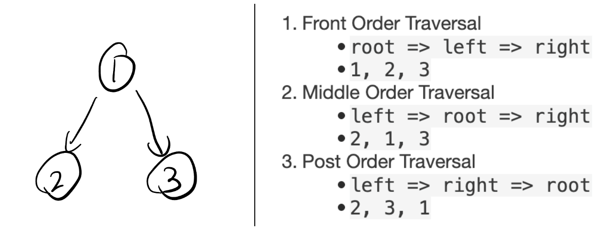
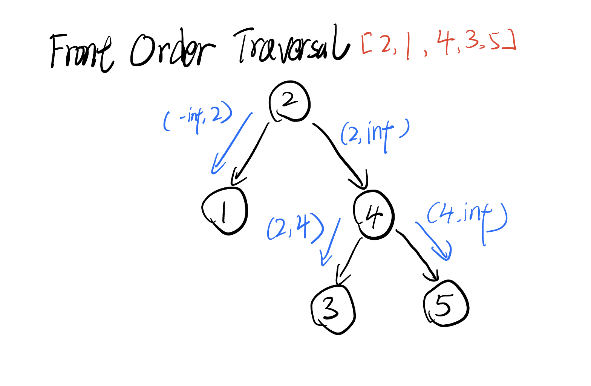
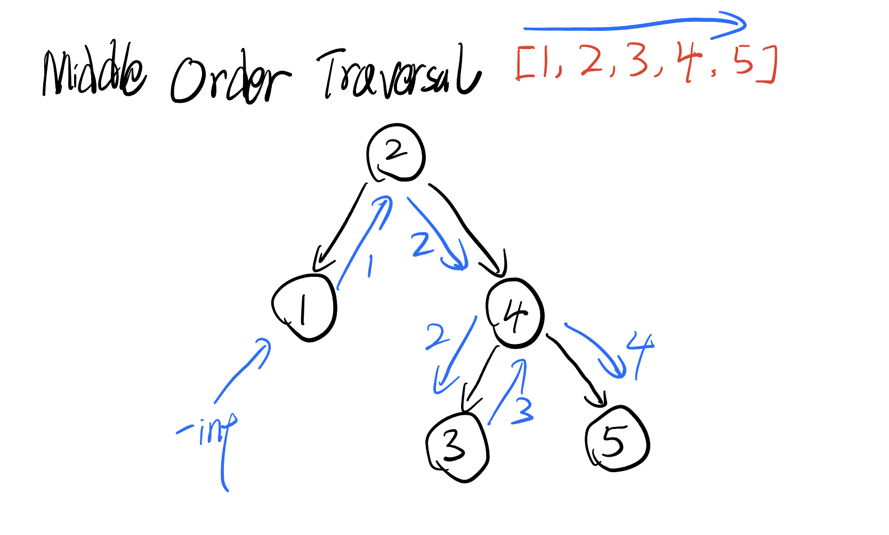
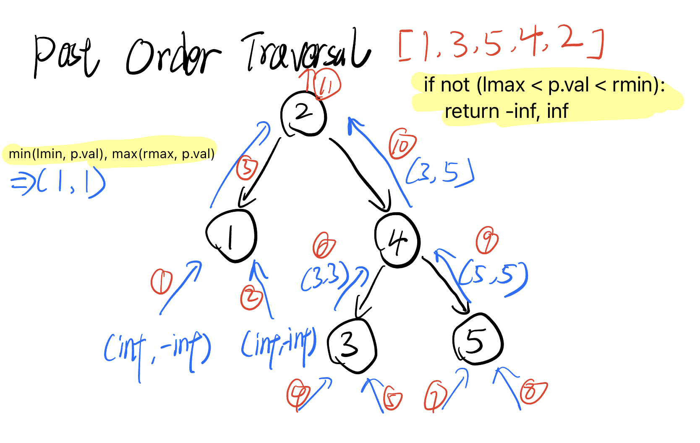

# 二叉树前中后向遍历 Binary Tree Front, Middle, and Post Order Traversal

## 思路

### 前序、中序与后序遍历



### 递归遍历模板

以中序遍历为例：

```python
# Definition for a binary tree node.
class TreeNode:
    def __init__(self, val=0, left=None, right=None):
        self.val = val
        self.left = left
        self.right = right

res = []
def dfs(node):
    if node == None: 
        return None

    # Front-order traversal
    res.append(node.val)

    if node.left: 
        dfs(node.left)

    # Middle-order traversal
    # res.append(node.val)

    if node.right: 
        dfs(node.right)
 
    # Post-order traversal
    # res.append(node.val)

    return None

root = TreeNode(1)
root.left = TreeNode(2)
root.right = TreeNode(3)
dfs(root)
print(res)
# front: [1, 2, 3]
# middle: [2, 1, 3]
# post: [2, 3, 1]
```

### 迭代遍历模板

在递归中，节点的访问关系是存在函数调用栈中的。

如果我们想用迭代的方法来实现树的前中后序访问，我们需要一个栈，以及记录节点被访问与否。

- 方法一：在栈中给待处理的 `root` 结点配一个空结点标记，用来区分“继续展开”与“正式访问”。
- 方法二：用访问标记表记录结点是否已经展开或加入结果集。

下面代码为中序遍历，在 root 节点上压入 null 节点来辨别 root 节点。

```python
def iterateTree(node):
    res = []
    stack = []
    if node != None:
        stack.append(node)
    while len(stack) > 0:
        # Check if the top of the stack is None
        cur = stack[-1]
        if cur != None:
            cur = stack.pop()

            # # Post-order traversal
            # stack.append(cur)
            # stack.append(None)

            if cur.right != None:
                stack.append(cur.right)
            
            # # Middle-order traversal
            # stack.append(cur)
            # stack.append(None) # The middle node is visited but not yet processed, use a Null Node to mark it

            if cur.left != None:
                stack.append(cur.left)

            # Front-order traversal
            stack.append(cur)
            stack.append(None)

        else:
            # If the top of the stack is None, it means we append the node to the result list
            stack.pop()
            cur = stack.pop()
            res.append(cur.val)
    return res

root = TreeNode(1)
root.left = TreeNode(2)
root.right = TreeNode(3)
print(iterateTree(root))
```

## 98. 验证二叉搜索树 / Validate Binary Search Tree

[LeetCode 中文站](https://leetcode.cn/problems/validate-binary-search-tree/) · [LeetCode 国际站](https://leetcode.com/problems/validate-binary-search-tree/)

**简要题意：** 判断二叉树是否为严格二叉搜索树：每个结点左子树的所有值都小于它，右子树的所有值都大于它；左右子树也必须满足此条件。不允许重复值。

### 递归解法

```python
# Definition for a binary tree node.
# class TreeNode:
#     def __init__(self, val=0, left=None, right=None):
#         self.val = val
#         self.left = left
#         self.right = right
class Solution:
    def isValidBST(self, root: Optional[TreeNode]) -> bool:
        def isBST(root, low, high):
            if root == None: return True
            if root.val >= high or root.val <= low: return False
            isLeftValid = isBST(root.left, low, root.val)
            isRightValid = isBST(root.right, root.val, high)
            return isLeftValid and isRightValid
        return isBST(root, float("-inf"), float("inf"))
```

### 前序遍历

可以把祖先结点带来的取值上下界传给子结点，从上到下检查每个结点是否处在合法范围内。



```python
# Definition for a binary tree node.
# class TreeNode:
#     def __init__(self, val=0, left=None, right=None):
#         self.val = val
#         self.left = left
#         self.right = right
class Solution:
    def isValidBST(self, root: Optional[TreeNode], left=-inf, right=inf) -> bool:
        if root == None:
            return True
        return left < root.val < right and self.isValidBST(root.left, left, root.val) and self.isValidBST(root.right, root.val, right)
```

### 中序遍历

二叉搜索树的中序遍历应当像遍历一个严格递增的数组。

- 当前结点的值必须严格大于前一个结点的值。（原文误写为“小于”，此处按中序递增的判定条件修正。）
- 将前一个结点的初始值设为负无穷 `-inf`，使第一个结点也能通过比较。



```python
# Definition for a binary tree node.
# class TreeNode:
#     def __init__(self, val=0, left=None, right=None):
#         self.val = val
#         self.left = left
#         self.right = right
class Solution:
    minValue = -inf
    def isValidBST(self, root: Optional[TreeNode]) -> bool:
        if root == None:
            return True
        if self.isValidBST(root.left) == False:
            return False
        if self.minValue >= root.val: 
            return False
        self.minValue = root.val
        if self.isValidBST(root.right) == False:
            return False
        return True
```

### 后序遍历

子树需要向上返回可用于验证的最小值与最大值，再检查根结点是否大于左子树所有值、且小于右子树所有值。



```python
# Definition for a binary tree node.
# class TreeNode:
#     def __init__(self, val=0, left=None, right=None):
#         self.val = val
#         self.left = left
#         self.right = right
class Solution:
    def isValidBST(self, root: Optional[TreeNode]) -> bool:
        def check(p):
            if p == None:
                return inf, -inf # Ensure the validation of Node with Empty subNode
            lmin, lmax = check(p.left)
            rmin, rmax = check(p.right)
            if not (lmax < p.val < rmin):
                return -inf, inf
            return min(lmin, p.val), max(rmax, p.val)
        return check(root)[1] != inf

```

## 105. 从前序与中序遍历序列构造二叉树 / Construct Binary Tree from Preorder and Inorder Traversal

[LeetCode 中文站](https://leetcode.cn/problems/construct-binary-tree-from-preorder-and-inorder-traversal/) · [LeetCode 国际站](https://leetcode.com/problems/construct-binary-tree-from-preorder-and-inorder-traversal/)

**简要题意：** 给定同一棵二叉树的前序和中序遍历，节点值互不相同，重建并返回二叉树。

```python
# Definition for a binary tree node.
# class TreeNode:
#     def __init__(self, val=0, left=None, right=None):
#         self.val = val
#         self.left = left
#         self.right = right
class Solution:
    def buildTree(self, preorder: List[int], inorder: List[int]) -> Optional[TreeNode]:
        if not preorder:
            return None
        rootVal = preoder[0]
        leftLen = inorder.index(rootVal)
        left = self.buildTree(preorder[1:1+leftLen], inorder[:leftLen])
        right = self.buildTree(preoder[1+leftLen], inorder[1+leftLen:])
        return TreeNode(preoder[0], left, right)
        
```

## 参考资料

1. [二叉树：前中后序迭代方式统一写法](https://zhuanlan.zhihu.com/p/260497281)
1. [二叉搜索树判断](https://www.bilibili.com/video/BV14G411P7C1/?spm_id_from=333.788&vd_source=66a0b89065d7f04805223fd7f2d613a6)
