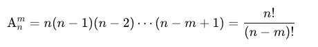
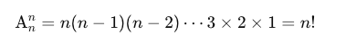

# 回溯之组合 Backtrace Combination

## 思路

### 排列数

从 `n` 个不同元素中取出 `m` 个元素，并按顺序排列，得到的不同排列的个数称为排列数，记作 `A(n, m)`。

```
A(n, m) = n(n-1)(n-2)...(n-m+1) = n!/(n-m)!

# A(4, 2) = 4! / (4-2)! = 4 x 3 = 12
# 4! = 4 x 3 x 2 x 1
# (4-2)! = 2! = 2 x 1
```

可以这样理解：从 `n` 个人中选出 `m <= n` 个人排成一队。第一个位置有 `n` 种选择，第二个位置有 `n−1` 种选择，以此类推，第 `m` 个位置有 `n−m+1` 种选择，因此将这些选择数相乘。



全排列就是把全部 `n` 个人排成一队，因此排列数为 `n!`。




### 组合数

> 从 n 个不同元素中取出 m(m≤n) 个元素的所有组合的个数，用符号 C(n,m) 表示。
>
> 从 4 个元素中选 2 个元素的组合数：C(4, 2) = A(4, 2) / 2! = 4! / 2! x (4-2)! = (4 x 3 x 2 x 1) / (2 x 1) x (2 x1) = 3 x 2 x1 = 6
>
> 如何理解？`A(n, m)` 会把同一组元素的不同排列分别计数，而组合不区分顺序。因此要除以这 `m` 个元素的 `m!` 种排列，即 `C(n,m) = A(n,m) / m!`。


## 示例

```
Input: n = 4, k = 2
Output: [[1,2],[1,3],[1,4],[2,3],[2,4],[3,4]]
```

## 77. 组合 / Combinations

[LeetCode 中文站](https://leetcode.cn/problems/combinations/) · [LeetCode 国际站](https://leetcode.com/problems/combinations/)

**简要题意：** 从整数 1 到 n 中选择 k 个不同数字，返回所有组合。组合与组合内顺序不限，不允许重复组合。

```python
class Solution:
    def combine(self, n: int, k: int) -> List[List[int]]:
        ans = []
        path = []
        def dfs(i):
            d  = k - len(path)
            if len(path) == k:
                ans.append(path.copy())
                return
            for j in range(i, d-1, -1):
                path.append(j)
                dfs(j-1)
                path.pop()
        dfs(n)
        return ans
```

## 216. 组合总和 III / Combination Sum III

[LeetCode 中文站](https://leetcode.cn/problems/combination-sum-iii/) · [LeetCode 国际站](https://leetcode.com/problems/combination-sum-iii/)

**简要题意：** 从 1 到 9 中选出 k 个互不相同的数，使其和为 n，返回全部组合。

```python
class Solution:
    def combinationSum3(self, k: int, n: int) -> List[List[int]]:
        ans = []
        path = []
        def dfs(i, t):
            d = k - len(path)
            if t < 0 or t > (i + i - d + 1) * d // 2:
                return
            if len(path) == k:
                ans.append(path.copy())
                return
            for j in range(i, d-1, -1):
                path.append(j)
                dfs(j-1, t-j)
                path.pop()
        dfs(9, n)
        return ans
```

## 22. 括号生成 / Generate Parentheses

[LeetCode 中文站](https://leetcode.cn/problems/generate-parentheses/) · [LeetCode 国际站](https://leetcode.com/problems/generate-parentheses/)

**简要题意：** 给定括号对数 n，生成由 n 对括号组成的所有合法括号字符串。

记录当前路径 `path` 中已经加入的左括号数量；加入右括号时，要保证它的数量不超过已加入的左括号数量。

```python
class Solution:
    def generateParenthesis(self, n: int) -> List[str]:
        ans = []
        path = [''] * (n*2)
        def dfs(i, left): # the number of left bracket
            if i == n*2:
                ans.append(''.join(path))
                return 
            if left < n:
                path[i] = '('
                dfs(i+1, left+1)
            if i-left < left:
                path[i] = ')'
                dfs(i+1, left)
        dfs(0, 0)
        return ans
```

## 参考资料

1. [组合型回溯，剪枝](https://www.bilibili.com/video/BV1xG4y1F7nC/?spm_id_from=333.788&vd_source=66a0b89065d7f04805223fd7f2d613a6)
1. [组合数学基础，排列组合](https://oi-wiki.org/math/combinatorics/combination/)
