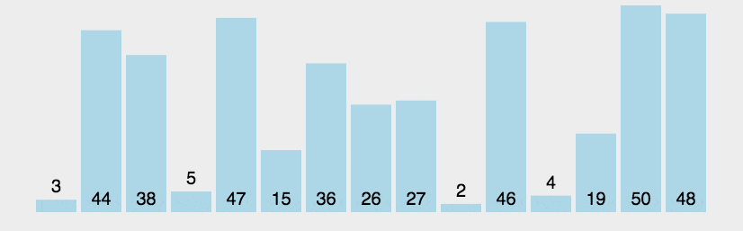
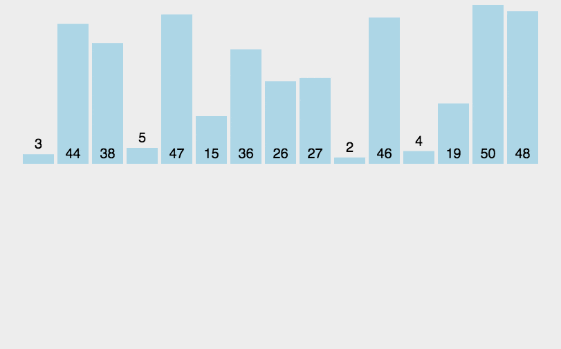
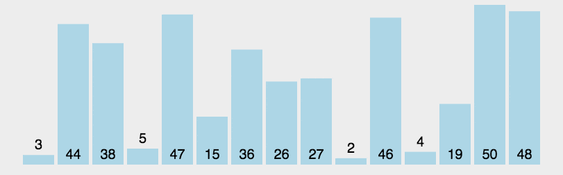

# 排序 Sort

## 思路


## 912. 排序数组 / Sort an Array

[LeetCode 中文站](https://leetcode.cn/problems/sort-an-array/) · [LeetCode 国际站](https://leetcode.com/problems/sort-an-array/)

**简要题意：** 将整数数组按非递减顺序排序，要求不使用内置排序函数，时间复杂度为 O(n log n)。

## 冒泡排序

算法步骤

- 逐对比较相邻元素，把未排序区域中最大的元素逐步交换到末尾，扩大已排序区域。

时间复杂度：`O(n²)`。

额外空间复杂度：`O(1)`。



```python
def bubbleSort(arr):
    for i in range(1, len(arr)):
        for j in range(0, len(arr)-i):
            if arr[j] > arr[j+1]:
                arr[j], arr[j + 1] = arr[j + 1], arr[j]
    return arr
```

## 插入排序

算法步骤

- 将数组划分为已排序区域与未排序区域。
- 取出未排序区域的第一个元素，插入已排序区域的正确位置。
- 重复以上步骤，直到全部元素有序。

时间复杂度：`O(n²)`。

额外空间复杂度：`O(1)`。



```python
def insertionSort(arr):
    for i in range(len(arr)):
        preIndex = i-1
        current = arr[i]
        while preIndex >= 0 and arr[preIndex] > current:
            arr[preIndex+1] = arr[preIndex]
            preIndex-=1
        arr[preIndex+1] = current
    return arr
```

## 归并排序

算法步骤

1. 将数组分成左右两个子数组。
   1. 递归地对两个子数组排序。

2. 合并已经有序的左右子数组。

时间复杂度：O(n log n)。

额外空间复杂度：O(n)。


```python
def mergeSort(arr):
    import math
    if(len(arr)<2):
        return arr
    middle = math.floor(len(arr)/2)
    left, right = arr[0:middle], arr[middle:]
    return merge(mergeSort(left), mergeSort(right))

def merge(left,right):
    result = []
    while left and right:
        if left[0] <= right[0]:
            result.append(left.pop(0))
        else:
            result.append(right.pop(0));
    while left:
        result.append(left.pop(0))
    while right:
        result.append(right.pop(0));
    return result
```

## 快速排序

算法步骤

1. 随机选择一个元素作为基准值。
2. 根据基准值将数组划分为两部分：
   1. 小于等于基准值的元素。
   2. 大于基准值的元素。
3. 对两部分递归执行以上步骤，直到子数组无需继续划分。

时间复杂度：平均 `O(n log n)`，最坏 `O(n²)`。下面的代码使用最左侧元素作为基准，而非随机基准；有序输入可能触发最坏情况。

额外空间复杂度：划分过程为 `O(1)`；递归栈平均为 `O(log n)`，最坏为 `O(n)`。



```python
def quickSort(arr, left=None, right=None):
    left = 0 if not isinstance(left,(int, float)) else left
    right = len(arr)-1 if not isinstance(right,(int, float)) else right
    if left < right:
        partitionIndex = partition(arr, left, right)
        quickSort(arr, left, partitionIndex-1)
        quickSort(arr, partitionIndex+1, right)
    return arr

def partition(arr, left, right):
    pivot = left
    index = pivot+1
    i = index
    while  i <= right:
        if arr[i] < arr[pivot]:
            swap(arr, i, index)
            index+=1
        i+=1
    swap(arr,pivot,index-1)
    return index-1

def swap(arr, i, j):
    arr[i], arr[j] = arr[j], arr[i]
```

## 参考资料

1. [我的算法博客](https://colalinn.github.io/2020/07/07/2020-07-07-algorithm/#more)
1. [归并排序讲解](https://www.runoob.com/w3cnote/merge-sort.html)
