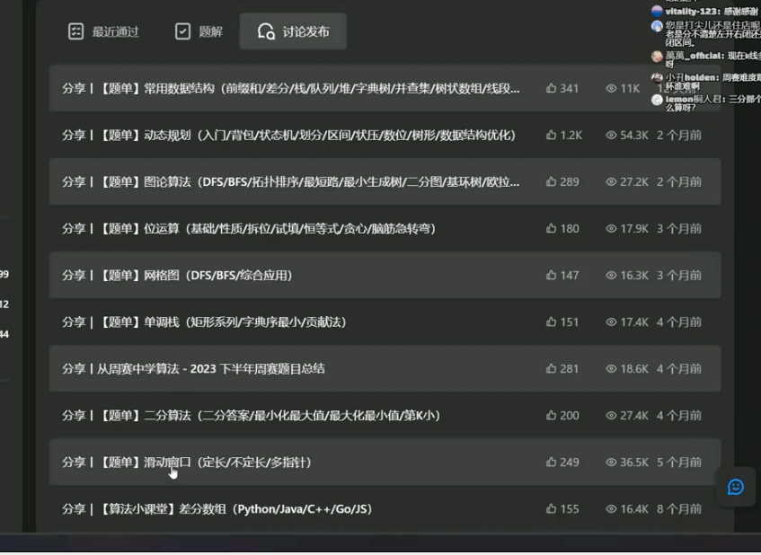
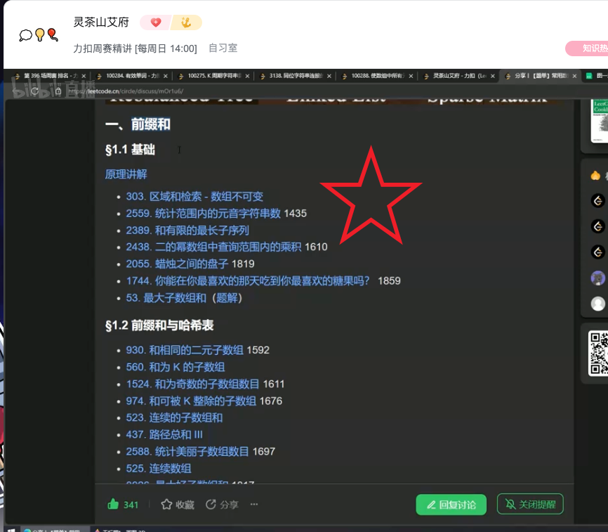

# 规划 Roadmap

重点学习：滑动窗口、二分、位运算、动态规划、字符串、图论、数学、贪心、常用数据结构（前缀和、堆栈、线段树）。

## 基础算法精讲题单，来自 [灵茶山艾府](https://github.com/EndlessCheng/codeforces-go/blob/master/leetcode/README.md)

| 视频精讲                                                     | 题目                                                         | 代码                                                         | 备注                     |
| ------------------------------------------------------------ | ------------------------------------------------------------ | ------------------------------------------------------------ | ------------------------ |
| [相向双指针 1](https://www.bilibili.com/video/BV1bP411c7oJ/) | [167. 两数之和 II - 输入有序数组 / Two Sum II - Input Array Is Sorted](https://leetcode.cn/problems/two-sum-ii-input-array-is-sorted/) [LeetCode 中文站](https://leetcode.cn/problems/two-sum-ii-input-array-is-sorted/) · [LeetCode 国际站](https://leetcode.com/problems/two-sum-ii-input-array-is-sorted/) **简要题意：** 在非递减数组中找到两个不同位置，使元素和为 target，返回从 1 开始的下标；保证恰有一组答案，要求常数额外空间。 | [代码](https://leetcode.cn/problems/two-sum-ii-input-array-is-sorted/solution/san-shu-zhi-he-bu-hui-xie-xiang-xiang-sh-6wbq/) |                          |
|                                                              | [15. 三数之和 / 3Sum](https://leetcode.cn/problems/3sum/) [LeetCode 中文站](https://leetcode.cn/problems/3sum/) · [LeetCode 国际站](https://leetcode.com/problems/3sum/) **简要题意：** 返回数组中所有由三个不同位置组成、元素之和为 0 的三元组。相同数值的三元组只返回一次，结果顺序不限。           | [代码](https://leetcode.cn/problems/3sum/solution/shuang-zhi-zhen-xiang-bu-ming-bai-yi-ge-pno55/) | 包含两个优化             |
|                                                              | [2824. 统计和小于目标的下标对数目 / Count Pairs Whose Sum is Less than Target](https://leetcode.cn/problems/count-pairs-whose-sum-is-less-than-target/) [LeetCode 中文站](https://leetcode.cn/problems/count-pairs-whose-sum-is-less-than-target/) · [LeetCode 国际站](https://leetcode.com/problems/count-pairs-whose-sum-is-less-than-target/) **简要题意：** 统计数组中下标 i 小于 j 且 nums[i] + nums[j] 小于 target 的数对数量。 | [代码](https://leetcode.cn/problems/count-pairs-whose-sum-is-less-than-target/solution/onlogn-pai-xu-shuang-zhi-zhen-by-endless-qk40/) | *课后作业                |
|                                                              | [16. 最接近的三数之和 / 3Sum Closest](https://leetcode.cn/problems/3sum-closest/) [LeetCode 中文站](https://leetcode.cn/problems/3sum-closest/) · [LeetCode 国际站](https://leetcode.com/problems/3sum-closest/) **简要题意：** 从整数数组中选取三个不同位置的数，返回最接近目标值 target 的三数之和。 | [代码](https://leetcode.cn/problems/3sum-closest/solution/ji-zhi-you-hua-ji-yu-san-shu-zhi-he-de-z-qgqi/) | *课后作业                |
|                                                              | [18. 四数之和 / 4Sum](https://leetcode.cn/problems/4sum/) [LeetCode 中文站](https://leetcode.cn/problems/4sum/) · [LeetCode 国际站](https://leetcode.com/problems/4sum/) **简要题意：** 找出数组中四个不同位置、元素和为 target 的所有不重复四元组。           | [代码](https://leetcode.cn/problems/4sum/solution/ji-zhi-you-hua-ji-yu-san-shu-zhi-he-de-z-1f0b/) | *课后作业                |
|                                                              | [611. 有效三角形的个数 / Valid Triangle Number](https://leetcode.cn/problems/valid-triangle-number/) [LeetCode 中文站](https://leetcode.cn/problems/valid-triangle-number/) · [LeetCode 国际站](https://leetcode.com/problems/valid-triangle-number/) **简要题意：** 从非负整数数组中选择三个不同下标，统计对应长度能组成非退化三角形的三元组数量。 | [代码](https://leetcode.cn/problems/valid-triangle-number/solution/zhuan-huan-cheng-abcyong-xiang-xiang-shu-1ex3/) | *课后作业                |
| [相向双指针 2](https://www.bilibili.com/video/BV1Qg411q7ia/) | [11. 盛最多水的容器 / Container With Most Water](https://leetcode.cn/problems/container-with-most-water/) [LeetCode 中文站](https://leetcode.cn/problems/container-with-most-water/) · [LeetCode 国际站](https://leetcode.com/problems/container-with-most-water/) **简要题意：** 在下标 i 处竖起高度为 `height[i]` 的线段。选择两条线段，与横轴构成容器。容量为两线段距离乘较短高度，返回最大容量。 | [代码](https://leetcode.cn/problems/container-with-most-water/solution/by-endlesscheng-f0xz/) |                          |
|                                                              | [42. 接雨水 / Trapping Rain Water](https://leetcode.cn/problems/trapping-rain-water/) [LeetCode 中文站](https://leetcode.cn/problems/trapping-rain-water/) · [LeetCode 国际站](https://leetcode.com/problems/trapping-rain-water/) **简要题意：** 给定宽度均为 1 的非负柱高数组，计算下雨后柱子之间能储存的总水量。 | [代码](https://leetcode.cn/problems/trapping-rain-water/solution/zuo-liao-nbian-huan-bu-hui-yi-ge-shi-pin-ukwm/) | 额外讲了**前后缀分解**   |
| [滑动窗口](https://www.bilibili.com/video/BV1hd4y1r7Gq/)     | [209. 长度最小的子数组 / Minimum Size Subarray Sum](https://leetcode.cn/problems/minimum-size-subarray-sum/) [LeetCode 中文站](https://leetcode.cn/problems/minimum-size-subarray-sum/) · [LeetCode 国际站](https://leetcode.com/problems/minimum-size-subarray-sum/) **简要题意：** 在正整数数组 `nums` 中，找和至少为 `target` 的最短非空连续子数组，返回长度；不存在时返回 0。 | [代码](https://leetcode.cn/problems/minimum-size-subarray-sum/solution/biao-ti-xia-biao-zong-suan-cuo-qing-kan-k81nh/) | 最短                     |
|                                                              | [3. 无重复字符的最长子串 / Longest Substring Without Repeating Characters](https://leetcode.cn/problems/longest-substring-without-repeating-characters/) [LeetCode 中文站](https://leetcode.cn/problems/longest-substring-without-repeating-characters/) · [LeetCode 国际站](https://leetcode.com/problems/longest-substring-without-repeating-characters/) **简要题意：** 给定字符串，返回不含重复字符的最长连续子串长度。 | [代码](https://leetcode.cn/problems/longest-substring-without-repeating-characters/solution/xia-biao-zong-suan-cuo-qing-kan-zhe-by-e-iaks/) | 最长                     |
|                                                              | [713. 乘积小于 K 的子数组 / Subarray Product Less Than K](https://leetcode.cn/problems/subarray-product-less-than-k/) [LeetCode 中文站](https://leetcode.cn/problems/subarray-product-less-than-k/) · [LeetCode 国际站](https://leetcode.com/problems/subarray-product-less-than-k/) **简要题意：** 给定正整数数组，统计元素乘积严格小于 k 的非空连续子数组数量。 | [代码](https://leetcode.cn/problems/subarray-product-less-than-k/solution/xia-biao-zong-suan-cuo-qing-kan-zhe-by-e-jebq/) | 方案数                   |
|                                                              | [2958. 最多 K 个重复元素的最长子数组 / Length Of Longest Subarray With At Most K Frequency](https://leetcode.cn/problems/length-of-longest-subarray-with-at-most-k-frequency/) [LeetCode 中文站](https://leetcode.cn/problems/length-of-longest-subarray-with-at-most-k-frequency/) · [LeetCode 国际站](https://leetcode.com/problems/length-of-longest-subarray-with-at-most-k-frequency/) **简要题意：** 找到最长连续子数组，要求其中每个数字出现次数都不超过 k，返回长度。 | [代码](https://leetcode.cn/problems/length-of-longest-subarray-with-at-most-k-frequency/solution/hua-dong-chuang-kou-fu-ti-dan-pythonjava-6fxo/) | *课后作业                |
|                                                              | [2730. 找到最长的半重复子字符串 / Find The Longest Semi Repetitive Substring](https://leetcode.cn/problems/find-the-longest-semi-repetitive-substring/) [LeetCode 中文站](https://leetcode.cn/problems/find-the-longest-semi-repetitive-substring/) · [LeetCode 国际站](https://leetcode.com/problems/find-the-longest-semi-repetitive-substring/) **简要题意：** 找到最长连续子串，使其中至多出现一对相邻且相等的字符，返回其长度。 | [代码](https://leetcode.cn/problems/find-the-longest-semi-repetitive-substring/solution/shuang-zhi-zhen-hua-chuang-pythonjavacgo-nurf/) | *课后作业                |
|                                                              | [1004. 最大连续 1 的个数 III / Max Consecutive Ones III](https://leetcode.cn/problems/max-consecutive-ones-iii/) [LeetCode 中文站](https://leetcode.cn/problems/max-consecutive-ones-iii/) · [LeetCode 国际站](https://leetcode.com/problems/max-consecutive-ones-iii/) **简要题意：** `nums` 只含 0 和 1。最多将 k 个 0 翻转为 1，返回可以得到的最长连续 1 的长度。 | [代码](https://leetcode.cn/problems/max-consecutive-ones-iii/solution/hua-dong-chuang-kou-yi-ge-shi-pin-jiang-yowmi/) | *课后作业                |
|                                                              | [2962. 统计最大元素出现至少 K 次的子数组 / Count Subarrays Where Max Element Appears At Least K Times](https://leetcode.cn/problems/count-subarrays-where-max-element-appears-at-least-k-times/) [LeetCode 中文站](https://leetcode.cn/problems/count-subarrays-where-max-element-appears-at-least-k-times/) · [LeetCode 国际站](https://leetcode.com/problems/count-subarrays-where-max-element-appears-at-least-k-times/) **简要题意：** 统计非空连续子数组的数量，要求整个数组的最大元素在子数组中至少出现 k 次。 | [代码](https://leetcode.cn/problems/count-subarrays-where-max-element-appears-at-least-k-times/solution/hua-dong-chuang-kou-fu-ti-dan-pythonjava-xvwg/) | *课后作业                |
|                                                              | [2302. 统计得分小于 K 的子数组数目 / Count Subarrays With Score Less Than K](https://leetcode.cn/problems/count-subarrays-with-score-less-than-k/) [LeetCode 中文站](https://leetcode.cn/problems/count-subarrays-with-score-less-than-k/) · [LeetCode 国际站](https://leetcode.com/problems/count-subarrays-with-score-less-than-k/) **简要题意：** 正整数数组中，子数组得分为元素和乘以长度，统计得分严格小于 k 的非空连续子数组数。 | [代码](https://leetcode.cn/problems/count-subarrays-with-score-less-than-k/solution/by-endlesscheng-b120/) | *课后作业                |
|                                                              | [1658. 将 x 减到 0 的最小操作数 / Minimum Operations To Reduce X To Zero](https://leetcode.cn/problems/minimum-operations-to-reduce-x-to-zero/) [LeetCode 中文站](https://leetcode.cn/problems/minimum-operations-to-reduce-x-to-zero/) · [LeetCode 国际站](https://leetcode.com/problems/minimum-operations-to-reduce-x-to-zero/) **简要题意：** 每次删除数组最左或最右的元素，并从 x 中减去其值，求使 x 恰好变为 0 的最少次数；无法完成则返回 -1。 | [代码](https://leetcode.cn/problems/minimum-operations-to-reduce-x-to-zero/solution/ni-xiang-si-wei-pythonjavacgo-by-endless-b4jt/) | *课后作业                |
|                                                              | [1234. 替换子串得到平衡字符串 / Replace The Substring For Balanced String](https://leetcode.cn/problems/replace-the-substring-for-balanced-string/) [LeetCode 中文站](https://leetcode.cn/problems/replace-the-substring-for-balanced-string/) · [LeetCode 国际站](https://leetcode.com/problems/replace-the-substring-for-balanced-string/) **简要题意：** 字符串只含 Q、W、E、R，长度是 4 的倍数；替换一个最短子串，使四种字符各占总长度的四分之一，返回最短长度。 | [代码](https://leetcode.cn/problems/replace-the-substring-for-balanced-string/solution/tong-xiang-shuang-zhi-zhen-hua-dong-chua-z7tu/) | *课后作业                |
|                                                              | [76. 最小覆盖子串 / Minimum Window Substring](https://leetcode.cn/problems/minimum-window-substring/) [LeetCode 中文站](https://leetcode.cn/problems/minimum-window-substring/) · [LeetCode 国际站](https://leetcode.com/problems/minimum-window-substring/) **简要题意：** 在字符串 s 中找到包含 t 全部字符及其重复次数的最短连续子串；不存在则返回空串。 | [代码](https://leetcode.cn/problems/minimum-window-substring/solution/liang-chong-fang-fa-cong-o52mn-dao-omnfu-3ezz/) | *课后作业                |
| [二分查找](https://www.bilibili.com/video/BV1AP41137w7/)     | [34. 在排序数组中查找元素的第一个和最后一个位置 / Find First and Last Position of Element in Sorted Array](https://leetcode.cn/problems/find-first-and-last-position-of-element-in-sorted-array/) [LeetCode 中文站](https://leetcode.cn/problems/find-first-and-last-position-of-element-in-sorted-array/) · [LeetCode 国际站](https://leetcode.com/problems/find-first-and-last-position-of-element-in-sorted-array/) **简要题意：** `nums` 按非递减顺序排列。返回 target 的首次与末次出现下标；不存在则返回 `[-1,-1]`。要求 O(log n) 时间。 | [代码](https://leetcode.cn/problems/find-first-and-last-position-of-element-in-sorted-array/solution/er-fen-cha-zhao-zong-shi-xie-bu-dui-yi-g-t9l9/) | 三种写法                 |
|                                                              | [2529. 正整数和负整数的最大计数 / Maximum Count of Positive Integer and Negative Integer](https://leetcode.cn/problems/maximum-count-of-positive-integer-and-negative-integer/) [LeetCode 中文站](https://leetcode.cn/problems/maximum-count-of-positive-integer-and-negative-integer/) · [LeetCode 国际站](https://leetcode.com/problems/maximum-count-of-positive-integer-and-negative-integer/) **简要题意：** 给定非递减整数数组，分别统计正数和负数个数，返回两者的较大值，0 不计入任一类。 | [代码](https://leetcode.cn/problems/maximum-count-of-positive-integer-and-negative-integer/solution/mo-ni-by-endlesscheng-8e43/) | *课后作业                |
|                                                              | [2300. 咒语和药水的成功对数 / Successful Pairs Of Spells And Potions](https://leetcode.cn/problems/successful-pairs-of-spells-and-potions/) [LeetCode 中文站](https://leetcode.cn/problems/successful-pairs-of-spells-and-potions/) · [LeetCode 国际站](https://leetcode.com/problems/successful-pairs-of-spells-and-potions/) **简要题意：** 给定咒语和药水的强度，对每个咒语统计与之强度乘积至少达到 success 的药水数量。 | [代码](https://leetcode.cn/problems/successful-pairs-of-spells-and-potions/solution/by-endlesscheng-1kbp/) | *课后作业                |
|                                                              | [2563. 统计公平数对的数目 / Count The Number Of Fair Pairs](https://leetcode.cn/problems/count-the-number-of-fair-pairs/) [LeetCode 中文站](https://leetcode.cn/problems/count-the-number-of-fair-pairs/) · [LeetCode 国际站](https://leetcode.com/problems/count-the-number-of-fair-pairs/) **简要题意：** 统计满足 i 小于 j 且两数之和位于闭区间 [lower, upper] 的下标对数量。 | [代码](https://leetcode.cn/problems/count-the-number-of-fair-pairs/solution/er-fen-cha-zhao-de-ling-huo-yun-yong-by-wplbj/) | *课后作业                |
|                                                              | [2080. 区间内查询数字的频率 / Range Frequency Queries](https://leetcode.cn/problems/range-frequency-queries/) [LeetCode 中文站](https://leetcode.cn/problems/range-frequency-queries/) · [LeetCode 国际站](https://leetcode.com/problems/range-frequency-queries/) **简要题意：** 设计查询结构，对给定闭区间 [left, right] 和 value，返回该值在原数组该区间内出现的次数。 | [代码](https://leetcode.cn/problems/range-frequency-queries/solution/tong-ji-wei-zhi-er-fen-wei-zhi-by-endles-8l9u/) | *课后作业                |
|                                                              | [275. H 指数 II / H-Index II](https://leetcode.cn/problems/h-index-ii/) [LeetCode 中文站](https://leetcode.cn/problems/h-index-ii/) · [LeetCode 国际站](https://leetcode.com/problems/h-index-ii/) **简要题意：** 给定按非递减顺序排列的引用次数，求最大的 h，使至少 h 篇论文各被引用至少 h 次，要求对数时间复杂度。   | [代码](https://leetcode.cn/problems/h-index-ii/solution/tu-jie-yi-tu-zhang-wo-er-fen-da-an-si-ch-d15k/) | *课后作业                |
|                                                              | [875. 爱吃香蕉的珂珂 / Koko Eating Bananas](https://leetcode.cn/problems/koko-eating-bananas/) [LeetCode 中文站](https://leetcode.cn/problems/koko-eating-bananas/) · [LeetCode 国际站](https://leetcode.com/problems/koko-eating-bananas/) **简要题意：** 每小时选择一堆香蕉并以固定速度吃，吃完后该小时不再吃其他堆，求 h 小时内吃完所有香蕉的最小整数速度。 | [代码](https://leetcode.cn/problems/koko-eating-bananas/solution/er-fen-da-an-fu-ti-dan-pythonjavacgojsru-eb18/) | *课后作业                |
|                                                              | [2187. 完成旅途的最少时间 / Minimum Time To Complete Trips](https://leetcode.cn/problems/minimum-time-to-complete-trips/) [LeetCode 中文站](https://leetcode.cn/problems/minimum-time-to-complete-trips/) · [LeetCode 国际站](https://leetcode.com/problems/minimum-time-to-complete-trips/) **简要题意：** 每辆公交车完成一趟需要固定时间，可独立连续运行，求所有公交车累计完成 totalTrips 趟所需的最少时间。 | [代码](https://leetcode.cn/problems/minimum-time-to-complete-trips/solution/er-fen-da-an-python-yi-xing-gao-ding-by-xwvs8/) | *课后作业                |
|                                                              | [2861. 最大合金数 / Maximum Number Of Alloys](https://leetcode.cn/problems/maximum-number-of-alloys/) [LeetCode 中文站](https://leetcode.cn/problems/maximum-number-of-alloys/) · [LeetCode 国际站](https://leetcode.com/problems/maximum-number-of-alloys/) **简要题意：** 给定多台机器的金属配方、库存、购买单价和预算，只使用同一台机器生产，求最多能制造的合金数量。 | [代码](https://leetcode.cn/problems/maximum-number-of-alloys/solution/er-fen-da-an-fu-ti-dan-by-endlesscheng-3jdr/) | *课后作业                |
|                                                              | [2439. 最小化数组中的最大值 / Minimize Maximum Of Array](https://leetcode.cn/problems/minimize-maximum-of-array/) [LeetCode 中文站](https://leetcode.cn/problems/minimize-maximum-of-array/) · [LeetCode 国际站](https://leetcode.com/problems/minimize-maximum-of-array/) **简要题意：** 每次可将下标大于 0 的某个正数减 1，并给它左侧相邻元素加 1，求任意次操作后数组最大值的最小可能值。 | [代码](https://leetcode.cn/problems/minimize-maximum-of-array/solution/liang-chong-zuo-fa-er-fen-da-an-fen-lei-qhee6/) | *课后作业                |
|                                                              | [2517. 礼盒的最大甜蜜度 / Maximum Tastiness Of Candy Basket](https://leetcode.cn/problems/maximum-tastiness-of-candy-basket/) [LeetCode 中文站](https://leetcode.cn/problems/maximum-tastiness-of-candy-basket/) · [LeetCode 国际站](https://leetcode.com/problems/maximum-tastiness-of-candy-basket/) **简要题意：** 从不同糖果种类中选 k 种，甜蜜度为所选价格两两差的绝对值的最小值，求最大甜蜜度。 | [代码](https://leetcode.cn/problems/maximum-tastiness-of-candy-basket/solution/er-fen-da-an-by-endlesscheng-r418/) | *课后作业                |
| [二分查找 - 变形](https://www.bilibili.com/video/BV1QK411d76w/) | [162. 寻找峰值 / Find Peak Element](https://leetcode.cn/problems/find-peak-element/) [LeetCode 中文站](https://leetcode.cn/problems/find-peak-element/) · [LeetCode 国际站](https://leetcode.com/problems/find-peak-element/) **简要题意：** 数组相邻元素不相等，两端外侧视为负无穷，返回任意一个严格大于相邻元素的峰值下标，要求对数时间复杂度。 | [代码](https://leetcode.cn/problems/find-peak-element/solution/by-endlesscheng-9ass/) |                          |
|                                                              | [153. 寻找旋转排序数组中的最小值 / Find Minimum in Rotated Sorted Array](https://leetcode.cn/problems/find-minimum-in-rotated-sorted-array/) [LeetCode 中文站](https://leetcode.cn/problems/find-minimum-in-rotated-sorted-array/) · [LeetCode 国际站](https://leetcode.com/problems/find-minimum-in-rotated-sorted-array/) **简要题意：** 严格递增数组经过旋转，元素互不相同，找出最小值，要求对数时间复杂度。 | [代码](https://leetcode.cn/problems/find-minimum-in-rotated-sorted-array/solution/by-endlesscheng-owgd/) |                          |
|                                                              | [33. 搜索旋转排序数组 / Search in Rotated Sorted Array](https://leetcode.cn/problems/search-in-rotated-sorted-array/) [LeetCode 中文站](https://leetcode.cn/problems/search-in-rotated-sorted-array/) · [LeetCode 国际站](https://leetcode.com/problems/search-in-rotated-sorted-array/) **简要题意：** 严格递增数组在某个位置旋转后得到 `nums`。返回 target 在当前数组中的下标；不存在时返回 -1。要求 O(log n) 时间。 | [代码](https://leetcode.cn/problems/search-in-rotated-sorted-array/solution/by-endlesscheng-auuh/) | 两种方法                 |
|                                                              | [1901. 寻找峰值 II / Find A Peak Element II](https://leetcode.cn/problems/find-a-peak-element-ii/) [LeetCode 中文站](https://leetcode.cn/problems/find-a-peak-element-ii/) · [LeetCode 国际站](https://leetcode.com/problems/find-a-peak-element-ii/) **简要题意：** 二维矩阵中相邻元素不相等，矩阵外视为 -1，找到一个严格大于上、下、左、右相邻元素的位置。 | [代码](https://leetcode.cn/problems/find-a-peak-element-ii/solution/tu-jie-li-yong-xing-zui-da-zhi-pan-duan-r4e0n/) | *课后作业                |
|                                                              | [154. 寻找旋转排序数组中的最小值 II / Find Minimum in Rotated Sorted Array II](https://leetcode.cn/problems/find-minimum-in-rotated-sorted-array-ii/) [LeetCode 中文站](https://leetcode.cn/problems/find-minimum-in-rotated-sorted-array-ii/) · [LeetCode 国际站](https://leetcode.com/problems/find-minimum-in-rotated-sorted-array-ii/) **简要题意：** 非递减数组经过旋转，元素可能重复，找出数组中的最小值。 | [代码](https://leetcode.cn/problems/find-minimum-in-rotated-sorted-array-ii/solution/zhi-yao-ni-hui-153-jiu-neng-kan-dong-pyt-qqc6/) | *课后作业                |
| [链表 - 反转系列](https://www.bilibili.com/video/BV1sd4y1x7KN/) | [206. 反转链表 / Reverse Linked List](https://leetcode.cn/problems/reverse-linked-list/) [LeetCode 中文站](https://leetcode.cn/problems/reverse-linked-list/) · [LeetCode 国际站](https://leetcode.com/problems/reverse-linked-list/) **简要题意：** 反转单链表中所有节点的连接方向，返回反转后的头节点；空链表返回空。 | [代码](https://leetcode.cn/problems/reverse-linked-list/solution/you-xie-cuo-liao-yi-ge-shi-pin-jiang-tou-o5zy/) |                          |
|                                                              | [92. 反转链表 II / Reverse Linked List II](https://leetcode.cn/problems/reverse-linked-list-ii/) [LeetCode 中文站](https://leetcode.cn/problems/reverse-linked-list-ii/) · [LeetCode 国际站](https://leetcode.com/problems/reverse-linked-list-ii/) **简要题意：** 反转单链表中从第 left 到第 right 个节点的部分，下标从 1 开始，其余节点保持不变。 | [代码](https://leetcode.cn/problems/reverse-linked-list-ii/solution/you-xie-cuo-liao-yi-ge-shi-pin-jiang-tou-teqq/) |                          |
|                                                              | [25. K 个一组翻转链表 / Reverse Nodes in k-Group](https://leetcode.cn/problems/reverse-nodes-in-k-group/) [LeetCode 中文站](https://leetcode.cn/problems/reverse-nodes-in-k-group/) · [LeetCode 国际站](https://leetcode.com/problems/reverse-nodes-in-k-group/) **简要题意：** 每 k 个节点为一组反转链表，最后不足 k 个的部分保持原样，不能只交换节点值。 | [代码](https://leetcode.cn/problems/reverse-nodes-in-k-group/solution/you-xie-cuo-liao-yi-ge-shi-pin-jiang-tou-plfs/) |                          |
|                                                              | [24. 两两交换链表中的节点 / Swap Nodes in Pairs](https://leetcode.cn/problems/swap-nodes-in-pairs/) [LeetCode 中文站](https://leetcode.cn/problems/swap-nodes-in-pairs/) · [LeetCode 国际站](https://leetcode.com/problems/swap-nodes-in-pairs/) **简要题意：** 两两交换链表中相邻节点，若最后剩一个节点则保持原样，不能只交换节点值。 | [代码](https://leetcode.cn/problems/swap-nodes-in-pairs/solution/tu-jie-die-dai-di-gui-yi-zhang-tu-miao-d-51ap) | *课后作业                |
|                                                              | [445. 两数相加 II / Add Two Numbers II](https://leetcode.cn/problems/add-two-numbers-ii/) [LeetCode 中文站](https://leetcode.cn/problems/add-two-numbers-ii/) · [LeetCode 国际站](https://leetcode.com/problems/add-two-numbers-ii/) **简要题意：** 两个非负整数按高位在前存入链表，返回它们的和，结果也用高位在前的链表表示。 | [代码](https://leetcode.cn/problems/add-two-numbers-ii/solution/fan-zhuan-lian-biao-liang-shu-xiang-jia-okw6q) | *课后作业                |
|                                                              | [2816. 翻倍以链表形式表示的数字 / Double a Number Represented as a Linked List](https://leetcode.cn/problems/double-a-number-represented-as-a-linked-list/) [LeetCode 中文站](https://leetcode.cn/problems/double-a-number-represented-as-a-linked-list/) · [LeetCode 国际站](https://leetcode.com/problems/double-a-number-represented-as-a-linked-list/) **简要题意：** 非负整数以高位在前的链表表示，将其乘以 2，并用相同形式返回结果。 | [代码](https://leetcode.cn/problems/double-a-number-represented-as-a-linked-list/solution/o1-kong-jian-zuo-fa-kan-cheng-shi-head-y-1dco/) | *课后作业                |
| [链表 - 快慢指针](https://www.bilibili.com/video/BV1KG4y1G7cu/) | [876. 链表的中间结点 / Middle of the Linked List](https://leetcode.cn/problems/middle-of-the-linked-list/) [LeetCode 中文站](https://leetcode.cn/problems/middle-of-the-linked-list/) · [LeetCode 国际站](https://leetcode.com/problems/middle-of-the-linked-list/) **简要题意：** 返回单链表的中间节点；节点数为偶数时，返回两个中间节点中的后一个。 | [代码](https://leetcode.cn/problems/middle-of-the-linked-list/solutions/1999265/mei-xiang-ming-bai-yi-ge-shi-pin-jiang-t-wzwm/) |                          |
|                                                              | [141. 环形链表 / Linked List Cycle](https://leetcode.cn/problems/linked-list-cycle/) [LeetCode 中文站](https://leetcode.cn/problems/linked-list-cycle/) · [LeetCode 国际站](https://leetcode.com/problems/linked-list-cycle/) **简要题意：** 判断单链表是否存在环，即能否沿 next 指针再次到达之前访问过的节点；要求不修改链表。 | [代码](https://leetcode.cn/problems/linked-list-cycle/solutions/1999269/mei-xiang-ming-bai-yi-ge-shi-pin-jiang-t-c4sw/) |                          |
|                                                              | [142. 环形链表 II / Linked List Cycle II](https://leetcode.cn/problems/linked-list-cycle-ii/) [LeetCode 中文站](https://leetcode.cn/problems/linked-list-cycle-ii/) · [LeetCode 国际站](https://leetcode.com/problems/linked-list-cycle-ii/) **简要题意：** 若链表有环，返回环的入口节点，否则返回空；不能修改链表。 | [代码](https://leetcode.cn/problems/linked-list-cycle-ii/solutions/1999271/mei-xiang-ming-bai-yi-ge-shi-pin-jiang-t-nvsq/) |                          |
|                                                              | [143. 重排链表 / Reorder List](https://leetcode.cn/problems/reorder-list/) [LeetCode 中文站](https://leetcode.cn/problems/reorder-list/) · [LeetCode 国际站](https://leetcode.com/problems/reorder-list/) **简要题意：** 将链表按首节点、尾节点、第二个节点、倒数第二个节点的次序重新连接，要求修改节点连接而非节点值。  | [代码](https://leetcode.cn/problems/reorder-list/solutions/1999276/mei-xiang-ming-bai-yi-ge-shi-pin-jiang-t-u66q/) |                          |
| [链表 - 删除系列](https://www.bilibili.com/video/BV1VP4y1Q71e/) | [237. 删除链表中的节点 / Delete Node in a Linked List](https://leetcode.cn/problems/delete-node-in-a-linked-list/) [LeetCode 中文站](https://leetcode.cn/problems/delete-node-in-a-linked-list/) · [LeetCode 国际站](https://leetcode.com/problems/delete-node-in-a-linked-list/) **简要题意：** 只给出单链表中待删除的节点，且该节点不是尾节点，在无法访问头节点的情况下删除它。 | [代码](https://leetcode.cn/problems/delete-node-in-a-linked-list/solutions/2004056/ru-he-shan-chu-jie-dian-liu-fen-zhong-ga-x3kn/) | 脑筋急转弯               |
|                                                              | [19. 删除链表的倒数第 N 个结点 / Remove Nth Node From End of List](https://leetcode.cn/problems/remove-nth-node-from-end-of-list/) [LeetCode 中文站](https://leetcode.cn/problems/remove-nth-node-from-end-of-list/) · [LeetCode 国际站](https://leetcode.com/problems/remove-nth-node-from-end-of-list/) **简要题意：** 删除单链表的倒数第 n 个结点，返回新头节点。n 从 1 开始；保证 n 不超过结点数量。 | [代码](https://leetcode.cn/problems/remove-nth-node-from-end-of-list/solutions/2004057/ru-he-shan-chu-jie-dian-liu-fen-zhong-ga-xpfs/) | 前后指针                 |
|                                                              | [83. 删除排序链表中的重复元素 / Remove Duplicates from Sorted List](https://leetcode.cn/problems/remove-duplicates-from-sorted-list/) [LeetCode 中文站](https://leetcode.cn/problems/remove-duplicates-from-sorted-list/) · [LeetCode 国际站](https://leetcode.com/problems/remove-duplicates-from-sorted-list/) **简要题意：** 给定有序链表，删除重复节点，使每个不同的值只保留一个节点。 | [代码](https://leetcode.cn/problems/remove-duplicates-from-sorted-list/solutions/2004062/ru-he-qu-zhong-yi-ge-shi-pin-jiang-tou-p-98g7/) |                          |
|                                                              | [82. 删除排序链表中的重复元素 II / Remove Duplicates from Sorted List II](https://leetcode.cn/problems/remove-duplicates-from-sorted-list-ii/) [LeetCode 中文站](https://leetcode.cn/problems/remove-duplicates-from-sorted-list-ii/) · [LeetCode 国际站](https://leetcode.com/problems/remove-duplicates-from-sorted-list-ii/) **简要题意：** 给定有序链表，删除所有出现重复值的节点，只保留原本仅出现一次的值。 | [代码](https://leetcode.cn/problems/remove-duplicates-from-sorted-list-ii/solutions/2004067/ru-he-qu-zhong-yi-ge-shi-pin-jiang-tou-p-2ddn/) |                          |
| [二叉树与递归 - 深入理解](https://www.bilibili.com/video/BV1UD4y1Y769/) | [104. 二叉树的最大深度 / Maximum Depth of Binary Tree](https://leetcode.cn/problems/maximum-depth-of-binary-tree/) [LeetCode 中文站](https://leetcode.cn/problems/maximum-depth-of-binary-tree/) · [LeetCode 国际站](https://leetcode.com/problems/maximum-depth-of-binary-tree/) **简要题意：** 返回二叉树从根节点到最远叶节点路径上的节点数；空树深度为 0。 | [代码](https://leetcode.cn/problems/maximum-depth-of-binary-tree/solution/kan-wan-zhe-ge-shi-pin-rang-ni-dui-di-gu-44uz/) | 两种方法                 |
|                                                              | [111. 二叉树的最小深度 / Minimum Depth Of Binary Tree](https://leetcode.cn/problems/minimum-depth-of-binary-tree/) [LeetCode 中文站](https://leetcode.cn/problems/minimum-depth-of-binary-tree/) · [LeetCode 国际站](https://leetcode.com/problems/minimum-depth-of-binary-tree/) **简要题意：** 求根节点到最近叶节点路径上的节点数；叶节点没有左右子节点。 | [代码](https://leetcode.cn/problems/minimum-depth-of-binary-tree/solution/liang-chong-fang-fa-zi-ding-xiang-xia-zi-0sxz/) | *课后作业                |
|                                                              | [112. 路径总和 / Path Sum](https://leetcode.cn/problems/path-sum/) [LeetCode 中文站](https://leetcode.cn/problems/path-sum/) · [LeetCode 国际站](https://leetcode.com/problems/path-sum/) **简要题意：** 判断二叉树是否存在从根到叶的路径，使路径节点值之和等于 targetSum。      | [代码](https://leetcode.cn/problems/path-sum/solution/jian-ji-xie-fa-pythonjavacgojsrust-by-en-icwe/) | *课后作业                |
|                                                              | [129. 求根节点到叶节点数字之和 / Sum Root To Leaf Numbers](https://leetcode.cn/problems/sum-root-to-leaf-numbers/) [LeetCode 中文站](https://leetcode.cn/problems/sum-root-to-leaf-numbers/) · [LeetCode 国际站](https://leetcode.com/problems/sum-root-to-leaf-numbers/) **简要题意：** 节点值为 0 到 9，每条根到叶路径按顺序组成一个十进制数，求所有这些数的总和。 | [代码](https://leetcode.cn/problems/sum-root-to-leaf-numbers/solution/jian-ji-xie-fa-pythonjavacgojsrust-by-en-gbu9/) | *课后作业                |
|                                                              | [1448. 统计二叉树中好节点的数目 / Count Good Nodes In Binary Tree](https://leetcode.cn/problems/count-good-nodes-in-binary-tree/) [LeetCode 中文站](https://leetcode.cn/problems/count-good-nodes-in-binary-tree/) · [LeetCode 国际站](https://leetcode.com/problems/count-good-nodes-in-binary-tree/) **简要题意：** 若从根到某节点的路径上没有比该节点值更大的节点，则该节点为好节点，求好节点总数。 | [代码](https://leetcode.cn/problems/count-good-nodes-in-binary-tree/solution/jian-ji-xie-fa-pythonjavacgojs-by-endles-gwxt/) | *课后作业                |
|                                                              | [987. 二叉树的垂序遍历 / Vertical Order Traversal Of A Binary Tree](https://leetcode.cn/problems/vertical-order-traversal-of-a-binary-tree/) [LeetCode 中文站](https://leetcode.cn/problems/vertical-order-traversal-of-a-binary-tree/) · [LeetCode 国际站](https://leetcode.com/problems/vertical-order-traversal-of-a-binary-tree/) **简要题意：** 根坐标为 (0,0)，左右子节点分别向下一行并左右移一列；按列、行排序输出节点，同位置再按节点值升序排列。 | [代码](https://leetcode.cn/problems/vertical-order-traversal-of-a-binary-tree/solution/si-chong-xie-fa-dfsha-xi-biao-shuang-shu-tg6q/) | *课后作业                |
| [二叉树与递归 - 灵活运用](https://www.bilibili.com/video/BV18M411z7bb/) | [100. 相同的树 / Same Tree](https://leetcode.cn/problems/same-tree/) [LeetCode 中文站](https://leetcode.cn/problems/same-tree/) · [LeetCode 国际站](https://leetcode.com/problems/same-tree/) **简要题意：** 两棵二叉树的结构完全相同，且对应结点的值相等时称为相同的树。判断给定的 p、q 是否相同。     | [代码](https://leetcode.cn/problems/same-tree/solutions/2015056/ru-he-ling-huo-yun-yong-di-gui-lai-kan-s-empk/) |                          |
|                                                              | [101. 对称二叉树 / Symmetric Tree](https://leetcode.cn/problems/symmetric-tree/) [LeetCode 中文站](https://leetcode.cn/problems/symmetric-tree/) · [LeetCode 国际站](https://leetcode.com/problems/symmetric-tree/) **简要题意：** 判断二叉树是否关于根节点左右镜像对称，结构和对应节点值都必须匹配。 | [代码](https://leetcode.cn/problems/symmetric-tree/solutions/2015063/ru-he-ling-huo-yun-yong-di-gui-lai-kan-s-6dq5/) |                          |
|                                                              | [110. 平衡二叉树 / Balanced Binary Tree](https://leetcode.cn/problems/balanced-binary-tree/) [LeetCode 中文站](https://leetcode.cn/problems/balanced-binary-tree/) · [LeetCode 国际站](https://leetcode.com/problems/balanced-binary-tree/) **简要题意：** 判断二叉树是否平衡：每个节点的左右子树高度差都不超过 1。 | [代码](https://leetcode.cn/problems/balanced-binary-tree/solutions/2015068/ru-he-ling-huo-yun-yong-di-gui-lai-kan-s-c3wj/) |                          |
|                                                              | [199. 二叉树的右视图 / Binary Tree Right Side View](https://leetcode.cn/problems/binary-tree-right-side-view/) [LeetCode 中文站](https://leetcode.cn/problems/binary-tree-right-side-view/) · [LeetCode 国际站](https://leetcode.com/problems/binary-tree-right-side-view/) **简要题意：** 从右侧观察二叉树，返回从上到下每层最右边可见节点的值。 | [代码](https://leetcode.cn/problems/binary-tree-right-side-view/solutions/2015061/ru-he-ling-huo-yun-yong-di-gui-lai-kan-s-r1nc/) |                          |
|                                                              | [1026. 节点与其祖先之间的最大差值 / Maximum Difference Between Node And Ancestor](https://leetcode.cn/problems/maximum-difference-between-node-and-ancestor/) [LeetCode 中文站](https://leetcode.cn/problems/maximum-difference-between-node-and-ancestor/) · [LeetCode 国际站](https://leetcode.com/problems/maximum-difference-between-node-and-ancestor/) **简要题意：** 在二叉树中选取一个节点和它的某个祖先，求二者节点值之差的绝对值的最大值。 | [代码](https://leetcode.cn/problems/maximum-difference-between-node-and-ancestor/solution/liang-chong-fang-fa-zi-ding-xiang-xia-zi-wj9v/) | *课后作业                |
|                                                              | [1080. 根到叶路径上的不足节点 / Insufficient Nodes In Root To Leaf Paths](https://leetcode.cn/problems/insufficient-nodes-in-root-to-leaf-paths/) [LeetCode 中文站](https://leetcode.cn/problems/insufficient-nodes-in-root-to-leaf-paths/) · [LeetCode 国际站](https://leetcode.com/problems/insufficient-nodes-in-root-to-leaf-paths/) **简要题意：** 若经过某节点的每条原树根到叶路径的节点值之和都小于 limit，则该节点不足；同时删除所有不足节点，返回剩余树。 | [代码](https://leetcode.cn/problems/insufficient-nodes-in-root-to-leaf-paths/solution/jian-ji-xie-fa-diao-yong-zi-shen-pythonj-64lf/) | *课后作业                |
|                                                              | [1110. 删点成林 / Delete Nodes And Return Forest](https://leetcode.cn/problems/delete-nodes-and-return-forest/) [LeetCode 中文站](https://leetcode.cn/problems/delete-nodes-and-return-forest/) · [LeetCode 国际站](https://leetcode.com/problems/delete-nodes-and-return-forest/) **简要题意：** 删除二叉树中值位于给定集合的节点，返回剩余各棵树的根节点。 | [代码](https://leetcode.cn/problems/delete-nodes-and-return-forest/solution/he-shi-ji-lu-da-an-pythonjavacgo-by-endl-lpcd/) | *课后作业                |
| [二叉树与递归 - 前序/中序/后序](https://www.bilibili.com/video/BV14G411P7C1/) | [98. 验证二叉搜索树 / Validate Binary Search Tree](https://leetcode.cn/problems/validate-binary-search-tree/) [LeetCode 中文站](https://leetcode.cn/problems/validate-binary-search-tree/) · [LeetCode 国际站](https://leetcode.com/problems/validate-binary-search-tree/) **简要题意：** 判断二叉树是否为严格二叉搜索树：每个结点左子树的所有值都小于它，右子树的所有值都大于它；左右子树也必须满足此条件。不允许重复值。 | [代码](https://leetcode.cn/problems/validate-binary-search-tree/solutions/2020306/qian-xu-zhong-xu-hou-xu-san-chong-fang-f-yxvh/) | 三种方法                 |
|                                                              | [938. 二叉搜索树的范围和 / Range Sum of BST](https://leetcode.cn/problems/range-sum-of-bst/) [LeetCode 中文站](https://leetcode.cn/problems/range-sum-of-bst/) · [LeetCode 国际站](https://leetcode.com/problems/range-sum-of-bst/) **简要题意：** 返回二叉搜索树中节点值处于闭区间 [low, high] 的所有节点值之和。 | [代码](https://leetcode.cn/problems/range-sum-of-bst/solution/jian-ji-xie-fa-pythonjavacgojsrust-by-en-7jw4/) | *课后作业                |
|                                                              | [2476. 二叉搜索树最近节点查询 / Closest Nodes Queries In A Binary Search Tree](https://leetcode.cn/problems/closest-nodes-queries-in-a-binary-search-tree/) [LeetCode 中文站](https://leetcode.cn/problems/closest-nodes-queries-in-a-binary-search-tree/) · [LeetCode 国际站](https://leetcode.com/problems/closest-nodes-queries-in-a-binary-search-tree/) **简要题意：** 对每个查询值，返回二叉搜索树中不大于它的最大值和不小于它的最小值；不存在时对应返回 -1。 | [代码](https://leetcode.cn/problems/closest-nodes-queries-in-a-binary-search-tree/solution/zhong-xu-bian-li-er-fen-cha-zhao-pythonj-4ic0/) | *课后作业                |
|                                                              | [1373. 二叉搜索子树的最大键值和 / Maximum Sum BST in Binary Tree](https://leetcode.cn/problems/maximum-sum-bst-in-binary-tree/) [LeetCode 中文站](https://leetcode.cn/problems/maximum-sum-bst-in-binary-tree/) · [LeetCode 国际站](https://leetcode.com/problems/maximum-sum-bst-in-binary-tree/) **简要题意：** 在二叉树中找出满足严格二叉搜索树条件的子树，返回最大节点值之和；允许选择空树并得到 0。 | [代码](https://leetcode.cn/problems/maximum-sum-bst-in-binary-tree/solution/hou-xu-bian-li-pythonjavacgo-by-endlessc-gll3/) | *课后作业                |
|                                                              | [105. 从前序与中序遍历序列构造二叉树 / Construct Binary Tree from Preorder and Inorder Traversal](https://leetcode.cn/problems/construct-binary-tree-from-preorder-and-inorder-traversal/) [LeetCode 中文站](https://leetcode.cn/problems/construct-binary-tree-from-preorder-and-inorder-traversal/) · [LeetCode 国际站](https://leetcode.com/problems/construct-binary-tree-from-preorder-and-inorder-traversal/) **简要题意：** 给定同一棵二叉树的前序和中序遍历，节点值互不相同，重建并返回二叉树。 | [代码](https://leetcode.cn/problems/construct-binary-tree-from-preorder-and-inorder-traversal/solution/tu-jie-cong-on2-dao-onpythonjavacgojsrus-aob8/) | *课后作业                |
|                                                              | [106. 从中序与后序遍历序列构造二叉树 / Construct Binary Tree From Inorder And Postorder Traversal](https://leetcode.cn/problems/construct-binary-tree-from-inorder-and-postorder-traversal/) [LeetCode 中文站](https://leetcode.cn/problems/construct-binary-tree-from-inorder-and-postorder-traversal/) · [LeetCode 国际站](https://leetcode.com/problems/construct-binary-tree-from-inorder-and-postorder-traversal/) **简要题意：** 给定同一棵二叉树的中序和后序遍历，节点值互不相同，重建并返回二叉树。 | [代码](https://leetcode.cn/problems/construct-binary-tree-from-inorder-and-postorder-traversal/solution/tu-jie-cong-on2-dao-onpythonjavacgojsrus-w8ny/) | *课后作业                |
|                                                              | [889. 根据前序和后序遍历构造二叉树 / Construct Binary Tree From Preorder And Postorder Traversal](https://leetcode.cn/problems/construct-binary-tree-from-preorder-and-postorder-traversal/) [LeetCode 中文站](https://leetcode.cn/problems/construct-binary-tree-from-preorder-and-postorder-traversal/) · [LeetCode 国际站](https://leetcode.com/problems/construct-binary-tree-from-preorder-and-postorder-traversal/) **简要题意：** 给定节点值互不相同的前序和后序遍历，重建一棵符合两种遍历结果的二叉树；有多个答案时返回任意一个。 | [代码](https://leetcode.cn/problems/construct-binary-tree-from-preorder-and-postorder-traversal/solution/tu-jie-cong-on2-dao-onpythonjavacgojsrus-h0o5/) | *课后作业                |
| [二叉树与递归 - 最近公共祖先](https://www.bilibili.com/video/BV1W44y1Z7AR/) | [236. 二叉树的最近公共祖先 / Lowest Common Ancestor of a Binary Tree](https://leetcode.cn/problems/lowest-common-ancestor-of-a-binary-tree/) [LeetCode 中文站](https://leetcode.cn/problems/lowest-common-ancestor-of-a-binary-tree/) · [LeetCode 国际站](https://leetcode.com/problems/lowest-common-ancestor-of-a-binary-tree/) **简要题意：** 给定二叉树及其中两个节点，返回同时拥有这两个后代的最深节点；节点可以是自己的后代。 | [代码](https://leetcode.cn/problems/lowest-common-ancestor-of-a-binary-tree/solutions/2023872/fen-lei-tao-lun-luan-ru-ma-yi-ge-shi-pin-2r95/) |                          |
|                                                              | [235. 二叉搜索树的最近公共祖先 / Lowest Common Ancestor of a Binary Search Tree](https://leetcode.cn/problems/lowest-common-ancestor-of-a-binary-search-tree/) [LeetCode 中文站](https://leetcode.cn/problems/lowest-common-ancestor-of-a-binary-search-tree/) · [LeetCode 国际站](https://leetcode.com/problems/lowest-common-ancestor-of-a-binary-search-tree/) **简要题意：** 给定二叉搜索树及其中两个节点，返回同时拥有这两个后代的最深节点；节点可以是自己的后代。 | [代码](https://leetcode.cn/problems/lowest-common-ancestor-of-a-binary-search-tree/solutions/2023873/zui-jin-gong-gong-zu-xian-yi-ge-shi-pin-8h2zc/) |                          |
|                                                              | [1123. 最深叶节点的最近公共祖先 / Lowest Common Ancestor Of Deepest Leaves](https://leetcode.cn/problems/lowest-common-ancestor-of-deepest-leaves/) [LeetCode 中文站](https://leetcode.cn/problems/lowest-common-ancestor-of-deepest-leaves/) · [LeetCode 国际站](https://leetcode.com/problems/lowest-common-ancestor-of-deepest-leaves/) **简要题意：** 返回二叉树中所有最深叶节点的最近公共祖先。 | [代码](https://leetcode.cn/problems/lowest-common-ancestor-of-deepest-leaves/solution/liang-chong-di-gui-si-lu-pythonjavacgojs-xxnk/) | *课后作业                |
| [二叉树 - BFS](https://www.bilibili.com/video/BV1hG4y1277i/) | [102. 二叉树的层序遍历 / Binary Tree Level Order Traversal](https://leetcode.cn/problems/binary-tree-level-order-traversal/) [LeetCode 中文站](https://leetcode.cn/problems/binary-tree-level-order-traversal/) · [LeetCode 国际站](https://leetcode.com/problems/binary-tree-level-order-traversal/) **简要题意：** 按从上到下的层次遍历二叉树，每层从左到右。返回二维数组，每个子数组保存一层结点值。空树返回空数组。 | [代码](https://leetcode.cn/problems/binary-tree-level-order-traversal/solutions/2049807/bfs-wei-shi-yao-yao-yong-dui-lie-yi-ge-s-xlpz/) | 两种写法                 |
|                                                              | [103. 二叉树的锯齿形层序遍历 / Binary Tree Zigzag Level Order Traversal](https://leetcode.cn/problems/binary-tree-zigzag-level-order-traversal/) [LeetCode 中文站](https://leetcode.cn/problems/binary-tree-zigzag-level-order-traversal/) · [LeetCode 国际站](https://leetcode.com/problems/binary-tree-zigzag-level-order-traversal/) **简要题意：** 逐层遍历二叉树，第一层从左到右，之后每层交替方向，返回各层节点值。 | [代码](https://leetcode.cn/problems/binary-tree-zigzag-level-order-traversal/solutions/2049827/bfs-wei-shi-yao-yao-yong-dui-lie-yi-ge-s-xlv3/) | 两种写法                 |
|                                                              | [513. 找树左下角的值 / Find Bottom Left Tree Value](https://leetcode.cn/problems/find-bottom-left-tree-value/) [LeetCode 中文站](https://leetcode.cn/problems/find-bottom-left-tree-value/) · [LeetCode 国际站](https://leetcode.com/problems/find-bottom-left-tree-value/) **简要题意：** 返回二叉树最深一层最左侧节点的值。 | [代码](https://leetcode.cn/problems/find-bottom-left-tree-value/solutions/2049776/bfs-wei-shi-yao-yao-yong-dui-lie-yi-ge-s-f34y/) |                          |
|                                                              | [107. 二叉树的层序遍历 II / Binary Tree Level Order Traversal II](https://leetcode.cn/problems/binary-tree-level-order-traversal-ii/) [LeetCode 中文站](https://leetcode.cn/problems/binary-tree-level-order-traversal-ii/) · [LeetCode 国际站](https://leetcode.com/problems/binary-tree-level-order-traversal-ii/) **简要题意：** 按从底层到顶层的顺序返回二叉树各层节点值，每层内部从左到右排列。 | [代码](https://leetcode.cn/problems/binary-tree-level-order-traversal-ii/solution/bfs-wei-shi-yao-yao-yong-dui-lie-yi-ge-s-wmul/) | *课后作业                |
|                                                              | [116. 填充每个节点的下一个右侧节点指针 / Populating Next Right Pointers In Each Node](https://leetcode.cn/problems/populating-next-right-pointers-in-each-node/) [LeetCode 中文站](https://leetcode.cn/problems/populating-next-right-pointers-in-each-node/) · [LeetCode 国际站](https://leetcode.com/problems/populating-next-right-pointers-in-each-node/) **简要题意：** 给定完美二叉树，将每个节点的 next 指向同层右侧相邻节点；该层末尾指向空。 | [代码](https://leetcode.cn/problems/populating-next-right-pointers-in-each-node/solution/san-chong-fang-fa-dfsbfsbfslian-biao-fu-5alnq/) | *课后作业                |
|                                                              | [117. 填充每个节点的下一个右侧节点指针 II / Populating Next Right Pointers In Each Node II](https://leetcode.cn/problems/populating-next-right-pointers-in-each-node-ii/) [LeetCode 中文站](https://leetcode.cn/problems/populating-next-right-pointers-in-each-node-ii/) · [LeetCode 国际站](https://leetcode.com/problems/populating-next-right-pointers-in-each-node-ii/) **简要题意：** 给定任意二叉树，将每个节点的 next 指向同层右侧相邻节点；该层末尾指向空。 | [代码](https://leetcode.cn/problems/populating-next-right-pointers-in-each-node-ii/solution/san-chong-fang-fa-dfsbfsbfslian-biao-fu-1bmqp/) | *课后作业                |
|                                                              | [2415. 反转二叉树的奇数层 / Reverse Odd Levels Of Binary Tree](https://leetcode.cn/problems/reverse-odd-levels-of-binary-tree/) [LeetCode 中文站](https://leetcode.cn/problems/reverse-odd-levels-of-binary-tree/) · [LeetCode 国际站](https://leetcode.com/problems/reverse-odd-levels-of-binary-tree/) **简要题意：** 给定完美二叉树，将所有奇数层的节点值分别反转，根节点为第 0 层，树的连接结构不变。 | [代码](https://leetcode.cn/problems/reverse-odd-levels-of-binary-tree/solution/zhi-jie-jiao-huan-zhi-by-endlesscheng-o8ze/) | *课后作业                |
|                                                              | [2641. 二叉树的堂兄弟节点 II / Cousins In Binary Tree II](https://leetcode.cn/problems/cousins-in-binary-tree-ii/) [LeetCode 中文站](https://leetcode.cn/problems/cousins-in-binary-tree-ii/) · [LeetCode 国际站](https://leetcode.com/problems/cousins-in-binary-tree-ii/) **简要题意：** 将每个节点的值替换为同层中与它父节点不同的所有节点的原值之和，返回修改后的树。 | [代码](https://leetcode.cn/problems/cousins-in-binary-tree-ii/solution/bfssuan-liang-ci-pythonjavacgo-by-endles-b72a/) | *课后作业                |
| [回溯 - 子集型](https://www.bilibili.com/video/BV1mG4y1A7Gu/) | [17. 电话号码的字母组合 / Letter Combinations Of A Phone Number](https://leetcode.cn/problems/letter-combinations-of-a-phone-number/) [LeetCode 中文站](https://leetcode.cn/problems/letter-combinations-of-a-phone-number/) · [LeetCode 国际站](https://leetcode.com/problems/letter-combinations-of-a-phone-number/) **简要题意：** 给定由 2 到 9 组成的数字串，按电话键盘映射返回所有可能的字母组合。 | [代码](https://leetcode.cn/problems/letter-combinations-of-a-phone-number/solutions/2059416/hui-su-bu-hui-xie-tao-lu-zai-ci-pythonja-3orv/) | 引入回溯概念用           |
|                                                              | [78. 子集 / Subsets](https://leetcode.cn/problems/subsets/) [LeetCode 中文站](https://leetcode.cn/problems/subsets/) · [LeetCode 国际站](https://leetcode.com/problems/subsets/) **简要题意：** nums 中元素互不相同，返回它的所有子集，包含空集和全集。子集顺序及子集内元素顺序不限。            | [代码](https://leetcode.cn/problems/subsets/solutions/2059409/hui-su-bu-hui-xie-tao-lu-zai-ci-pythonja-8tkl/) | 两种写法                 |
|                                                              | [131. 分割回文串 / Palindrome Partitioning](https://leetcode.cn/problems/palindrome-partitioning/) [LeetCode 中文站](https://leetcode.cn/problems/palindrome-partitioning/) · [LeetCode 国际站](https://leetcode.com/problems/palindrome-partitioning/) **简要题意：** 将字符串切分为若干非空回文子串，返回所有切分方案。 | [代码](https://leetcode.cn/problems/palindrome-partitioning/solutions/2059414/hui-su-bu-hui-xie-tao-lu-zai-ci-pythonja-fues/) | 两种写法                 |
| [回溯 - 组合型与剪枝](https://www.bilibili.com/video/BV1xG4y1F7nC/) | [77. 组合 / Combinations](https://leetcode.cn/problems/combinations/) [LeetCode 中文站](https://leetcode.cn/problems/combinations/) · [LeetCode 国际站](https://leetcode.com/problems/combinations/) **简要题意：** 从整数 1 到 n 中选择 k 个不同数字，返回所有组合。组合与组合内顺序不限，不允许重复组合。       | [代码](https://leetcode.cn/problems/combinations/solutions/2071017/hui-su-bu-hui-xie-tao-lu-zai-ci-pythonja-65lh/) | 两种写法                 |
|                                                              | [216. 组合总和 III / Combination Sum III](https://leetcode.cn/problems/combination-sum-iii/) [LeetCode 中文站](https://leetcode.cn/problems/combination-sum-iii/) · [LeetCode 国际站](https://leetcode.com/problems/combination-sum-iii/) **简要题意：** 从 1 到 9 中选出 k 个互不相同的数，使其和为 n，返回全部组合。 | [代码](https://leetcode.cn/problems/combination-sum-iii/solutions/2071013/hui-su-bu-hui-xie-tao-lu-zai-ci-pythonja-feme/) | 两种写法                 |
|                                                              | [22. 括号生成 / Generate Parentheses](https://leetcode.cn/problems/generate-parentheses/) [LeetCode 中文站](https://leetcode.cn/problems/generate-parentheses/) · [LeetCode 国际站](https://leetcode.com/problems/generate-parentheses/) **简要题意：** 给定括号对数 n，生成由 n 对括号组成的所有合法括号字符串。 | [代码](https://leetcode.cn/problems/generate-parentheses/solutions/2071015/hui-su-bu-hui-xie-tao-lu-zai-ci-pythonja-wcdw/) | 两种写法                 |
|                                                              | [39. 组合总和 / Combination Sum](https://leetcode.cn/problems/combination-sum/) [LeetCode 中文站](https://leetcode.cn/problems/combination-sum/) · [LeetCode 国际站](https://leetcode.com/problems/combination-sum/) **简要题意：** 从互不相同的正整数 candidates 中选择若干数，使和等于 target。每个候选数可重复使用。返回所有不同的数值组合，顺序不限。 | [代码](https://leetcode.cn/problems/combination-sum/solution/liang-chong-fang-fa-xuan-huo-bu-xuan-mei-mhf9/) | *课后作业                |
| [回溯 - 排列型](https://www.bilibili.com/video/BV1mY411D7f6/) | [46. 全排列 / Permutations](https://leetcode.cn/problems/permutations/) [LeetCode 中文站](https://leetcode.cn/problems/permutations/) · [LeetCode 国际站](https://leetcode.com/problems/permutations/) **简要题意：** 给定元素互不相同的 nums，返回所有排列。结果数组的顺序不限，但每个排列内部的顺序代表一个不同答案。     | [代码](https://leetcode.cn/problems/permutations/solutions/2079585/hui-su-bu-hui-xie-tao-lu-zai-ci-jing-que-6hrh/) | 精确计算搜索树的节点个数 |
|                                                              | [51. N 皇后 / N-Queens](https://leetcode.cn/problems/n-queens/) [LeetCode 中文站](https://leetcode.cn/problems/n-queens/) · [LeetCode 国际站](https://leetcode.com/problems/n-queens/) **简要题意：** 在 n×n 棋盘上放置 n 个皇后，使任意两个不同行、不同列且不在同一斜线上，返回全部棋盘方案。         | [代码](https://leetcode.cn/problems/n-queens/solutions/2079586/hui-su-tao-lu-miao-sha-nhuang-hou-shi-pi-mljv/) |                          |
|                                                              | [52. N 皇后 II / N-Queens II](https://leetcode.cn/problems/n-queens-ii/) [LeetCode 中文站](https://leetcode.cn/problems/n-queens-ii/) · [LeetCode 国际站](https://leetcode.com/problems/n-queens-ii/) **简要题意：** 在 n×n 棋盘上放置 n 个互不攻击的皇后，返回不同方案的数量。   | [代码](https://leetcode.cn/problems/n-queens-ii/solution/hui-su-miao-sha-nhuang-hou-yi-ge-shi-pin-l41l) |                          |
|                                                              | [2850. 将石头分散到网格图的最少移动次数 / Minimum Moves To Spread Stones Over Grid](https://leetcode.cn/problems/minimum-moves-to-spread-stones-over-grid/) [LeetCode 中文站](https://leetcode.cn/problems/minimum-moves-to-spread-stones-over-grid/) · [LeetCode 国际站](https://leetcode.com/problems/minimum-moves-to-spread-stones-over-grid/) **简要题意：** 3×3 网格中共有 9 块石头，每次将一块石头移到上下左右相邻格，求每格恰有一块石头的最少移动次数。 | [代码](https://leetcode.cn/problems/minimum-moves-to-spread-stones-over-grid/solution/tong-yong-zuo-fa-zui-xiao-fei-yong-zui-d-iuw8/) | *课后作业                |
| [动态规划 - 从记忆化搜索到递推](https://www.bilibili.com/video/BV1Xj411K7oF/) | [198. 打家劫舍 / House Robber](https://leetcode.cn/problems/house-robber/) [LeetCode 中文站](https://leetcode.cn/problems/house-robber/) · [LeetCode 国际站](https://leetcode.com/problems/house-robber/) **简要题意：** 房屋沿直线排列，第 i 间存有 nums[i] 金额。不能同时选择相邻房屋，返回可获得的最大金额。可以不选择任何房屋。  | [代码](https://leetcode.cn/problems/house-robber/solutions/2102725/ru-he-xiang-chu-zhuang-tai-ding-yi-he-zh-1wt1/) | 包含空间优化             |
|                                                              | [70. 爬楼梯 / Climbing Stairs](https://leetcode.cn/problems/climbing-stairs/) [LeetCode 中文站](https://leetcode.cn/problems/climbing-stairs/) · [LeetCode 国际站](https://leetcode.com/problems/climbing-stairs/) **简要题意：** 到达 n 级楼梯顶部，每次可以上 1 级或 2 级。返回不同步长序列的数量。  | [代码](https://leetcode.cn/problems/climbing-stairs/solution/jiao-ni-yi-bu-bu-si-kao-dong-tai-gui-hua-7zm1/) | *课后作业                |
|                                                              | [746. 使用最小花费爬楼梯 / Min Cost Climbing Stairs](https://leetcode.cn/problems/min-cost-climbing-stairs/) [LeetCode 中文站](https://leetcode.cn/problems/min-cost-climbing-stairs/) · [LeetCode 国际站](https://leetcode.com/problems/min-cost-climbing-stairs/) **简要题意：** 给定每级台阶的花费，支付后可向上走一或两级，可从第 0 或第 1 级开始，求到达楼顶的最小花费。 | [代码](https://leetcode.cn/problems/min-cost-climbing-stairs/solution/jiao-ni-yi-bu-bu-si-kao-dong-tai-gui-hua-j99e/) | *课后作业                |
|                                                              | [377. 组合总和 Ⅳ / Combination Sum IV](https://leetcode.cn/problems/combination-sum-iv/) [LeetCode 中文站](https://leetcode.cn/problems/combination-sum-iv/) · [LeetCode 国际站](https://leetcode.com/problems/combination-sum-iv/) **简要题意：** 给定互不相同的正整数和目标值，每个数可重复使用，求总和等于目标值的有序序列数；不同顺序分别计数。 | [代码](https://leetcode.cn/problems/combination-sum-iv/solution/ben-zhi-shi-pa-lou-ti-cong-ji-yi-hua-sou-y52j/) | *课后作业                |
|                                                              | [2466. 统计构造好字符串的方案数 / Count Ways To Build Good Strings](https://leetcode.cn/problems/count-ways-to-build-good-strings/) [LeetCode 中文站](https://leetcode.cn/problems/count-ways-to-build-good-strings/) · [LeetCode 国际站](https://leetcode.com/problems/count-ways-to-build-good-strings/) **简要题意：** 从空串开始，每次追加 zero 个 0 或 one 个 1，统计长度位于 [low, high] 的不同字符串数，答案对 1000000007 取模。 | [代码](https://leetcode.cn/problems/count-ways-to-build-good-strings/solution/by-endlesscheng-4j22/) | *课后作业                |
|                                                              | [213. 打家劫舍 II / House Robber II](https://leetcode.cn/problems/house-robber-ii/) [LeetCode 中文站](https://leetcode.cn/problems/house-robber-ii/) · [LeetCode 国际站](https://leetcode.com/problems/house-robber-ii/) **简要题意：** 房屋围成一圈，相邻房屋不能同时偷窃，求可偷取的最大金额。 | [代码](https://leetcode.cn/problems/house-robber-ii/solution/jian-ji-xie-fa-zhi-jie-diao-yong-198-ti-qhvri/) | *课后作业                |
| [0-1 背包 完全背包 至多/恰好/至少](https://www.bilibili.com/video/BV16Y411v7Y6/) | [494. 目标和 / Target Sum](https://leetcode.cn/problems/target-sum/) [LeetCode 中文站](https://leetcode.cn/problems/target-sum/) · [LeetCode 国际站](https://leetcode.com/problems/target-sum/) **简要题意：** 在每个 nums[i] 前独立选择 + 或 -，将所有带符号的数相加。返回结果等于 target 的符号选择数量。+0 和 -0 是两种不同选择。      | [代码](https://leetcode.cn/problems/target-sum/solutions/2119041/jiao-ni-yi-bu-bu-si-kao-dong-tai-gui-hua-s1cx/) | 包含空间优化             |
|                                                              | [322. 零钱兑换 / Coin Change](https://leetcode.cn/problems/coin-change/) [LeetCode 中文站](https://leetcode.cn/problems/coin-change/) · [LeetCode 国际站](https://leetcode.com/problems/coin-change/) **简要题意：** 每种硬币有无限枚，求恰好凑出 amount 的最少硬币数。不可能时返回 -1，amount=0 时返回 0。   | [代码](https://leetcode.cn/problems/coin-change/solutions/2119065/jiao-ni-yi-bu-bu-si-kao-dong-tai-gui-hua-21m5/) | 包含空间优化             |
|                                                              | [2915. 和为目标值的最长子序列的长度 / Length Of The Longest Subsequence That Sums To Target](https://leetcode.cn/problems/length-of-the-longest-subsequence-that-sums-to-target/) [LeetCode 中文站](https://leetcode.cn/problems/length-of-the-longest-subsequence-that-sums-to-target/) · [LeetCode 国际站](https://leetcode.com/problems/length-of-the-longest-subsequence-that-sums-to-target/) **简要题意：** 从数组中按原顺序选取元素，使总和为 target，返回最长子序列长度；不存在时返回 -1。 | [代码](https://leetcode.cn/problems/length-of-the-longest-subsequence-that-sums-to-target/solution/mo-ban-qia-hao-zhuang-man-xing-0-1-bei-b-0nca/) | *课后作业                |
|                                                              | [416. 分割等和子集 / Partition Equal Subset Sum](https://leetcode.cn/problems/partition-equal-subset-sum/) [LeetCode 中文站](https://leetcode.cn/problems/partition-equal-subset-sum/) · [LeetCode 国际站](https://leetcode.com/problems/partition-equal-subset-sum/) **简要题意：** 判断能否把 nums 的全部元素分成两个互不重叠的子集，使两个子集的元素和相等。每个位置的元素只可使用一次。 | [代码](https://leetcode.cn/problems/partition-equal-subset-sum/solution/0-1-bei-bao-cong-ji-yi-hua-sou-suo-dao-d-ev76/) | *课后作业                |
|                                                              | [518. 零钱兑换 II / Coin Change II](https://leetcode.cn/problems/coin-change-ii/) [LeetCode 中文站](https://leetcode.cn/problems/coin-change-ii/) · [LeetCode 国际站](https://leetcode.com/problems/coin-change-ii/) **简要题意：** 给定硬币面额和总金额，每种硬币可使用任意次，求凑出该金额的组合数；不同排列算同一组合。 | [代码](https://leetcode.cn/problems/coin-change-ii/solution/shi-pin-wan-quan-bei-bao-cong-ji-yi-hua-o3ew0/) | *课后作业                |
| [最长公共子序列 LCS](https://www.bilibili.com/video/BV1TM4y1o7ug/) | [1143. 最长公共子序列 / Longest Common Subsequence](https://leetcode.cn/problems/longest-common-subsequence/) [LeetCode 中文站](https://leetcode.cn/problems/longest-common-subsequence/) · [LeetCode 国际站](https://leetcode.com/problems/longest-common-subsequence/) **简要题意：** 返回两个字符串的最长公共子序列长度。子序列保持相对顺序但不要求连续，没有公共字符时返回 0。 | [代码](https://leetcode.cn/problems/longest-common-subsequence/solutions/2133188/jiao-ni-yi-bu-bu-si-kao-dong-tai-gui-hua-lbz5/) | 包含空间优化             |
|                                                              | [72. 编辑距离 / Edit Distance](https://leetcode.cn/problems/edit-distance/) [LeetCode 中文站](https://leetcode.cn/problems/edit-distance/) · [LeetCode 国际站](https://leetcode.com/problems/edit-distance/) **简要题意：** 给定两个字符串，每次可插入、删除或替换一个字符，求将第一个字符串变成第二个的最少操作数。  | [代码](https://leetcode.cn/problems/edit-distance/solutions/2133222/jiao-ni-yi-bu-bu-si-kao-dong-tai-gui-hua-uo5q/) | 包含空间优化             |
| [最长递增子序列 LIS](https://www.bilibili.com/video/BV1ub411Q7sB/) | [300. 最长递增子序列 / Longest Increasing Subsequence](https://leetcode.cn/problems/longest-increasing-subsequence/) [LeetCode 中文站](https://leetcode.cn/problems/longest-increasing-subsequence/) · [LeetCode 国际站](https://leetcode.com/problems/longest-increasing-subsequence/) **简要题意：** 返回 nums 的最长严格递增子序列长度。子序列可以删除元素，但保留剩余元素的相对顺序，不要求连续。 | [代码](https://leetcode.cn/problems/longest-increasing-subsequence/solution/jiao-ni-yi-bu-bu-si-kao-dpfu-o1-kong-jia-4zma/) | 包括贪心二分 + 𝑂(1) 空间 |
|                                                              | [1671. 得到山形数组的最少删除次数 / Minimum Number Of Removals To Make Mountain Array](https://leetcode.cn/problems/minimum-number-of-removals-to-make-mountain-array/) [LeetCode 中文站](https://leetcode.cn/problems/minimum-number-of-removals-to-make-mountain-array/) · [LeetCode 国际站](https://leetcode.com/problems/minimum-number-of-removals-to-make-mountain-array/) **简要题意：** 删除尽量少的元素，使剩余序列先严格递增后严格递减，且峰顶两侧都非空，返回最少删除数量。 | [代码](https://leetcode.cn/problems/minimum-number-of-removals-to-make-mountain-array/solution/qian-hou-zhui-fen-jie-zui-chang-di-zeng-9vowl/) | *课后作业                |
|                                                              | [1626. 无矛盾的最佳球队 / Best Team With No Conflicts](https://leetcode.cn/problems/best-team-with-no-conflicts/) [LeetCode 中文站](https://leetcode.cn/problems/best-team-with-no-conflicts/) · [LeetCode 国际站](https://leetcode.com/problems/best-team-with-no-conflicts/) **简要题意：** 按年龄和得分选择球队，使年轻球员的得分不高于年长球员；同龄球员之间没有冲突，求最大总得分。 | [代码](https://leetcode.cn/problems/best-team-with-no-conflicts/solution/zui-chang-di-zeng-zi-xu-lie-cong-on2-dao-ojqu/) | *课后作业                |
| [状态机 DP - 买卖股票系列](https://www.bilibili.com/video/BV1ho4y1W7QK/) | [122. 买卖股票的最佳时机 II / Best Time to Buy and Sell Stock II](https://leetcode.cn/problems/best-time-to-buy-and-sell-stock-ii/) [LeetCode 中文站](https://leetcode.cn/problems/best-time-to-buy-and-sell-stock-ii/) · [LeetCode 国际站](https://leetcode.com/problems/best-time-to-buy-and-sell-stock-ii/) **简要题意：** prices[i] 为第 i 天股价。可完成多次买入卖出，但任意时刻最多持有一股。可在同一天先卖再买。返回最大总利润，不交易时利润为 0。 | [代码](https://leetcode.cn/problems/best-time-to-buy-and-sell-stock-ii/solution/shi-pin-jiao-ni-yi-bu-bu-si-kao-dong-tai-o3y4/) |                          |
|                                                              | [309. 买卖股票的最佳时机含冷冻期 / Best Time to Buy and Sell Stock with Cooldown](https://leetcode.cn/problems/best-time-to-buy-and-sell-stock-with-cooldown/) [LeetCode 中文站](https://leetcode.cn/problems/best-time-to-buy-and-sell-stock-with-cooldown/) · [LeetCode 国际站](https://leetcode.com/problems/best-time-to-buy-and-sell-stock-with-cooldown/) **简要题意：** 可以多次买卖股票且最多持有一股。卖出后的下一天是冷冻期，不能买入；再下一天可以。返回最大利润。 | [代码](https://leetcode.cn/problems/best-time-to-buy-and-sell-stock-with-cooldown/solution/shi-pin-jiao-ni-yi-bu-bu-si-kao-dong-tai-0k0l/) |                          |
|                                                              | [188. 买卖股票的最佳时机 IV / Best Time to Buy and Sell Stock IV](https://leetcode.cn/problems/best-time-to-buy-and-sell-stock-iv/) [LeetCode 中文站](https://leetcode.cn/problems/best-time-to-buy-and-sell-stock-iv/) · [LeetCode 国际站](https://leetcode.com/problems/best-time-to-buy-and-sell-stock-iv/) **简要题意：** 给定每日股价和交易上限 k，最多完成 k 次交易，同一时间只能持有一股，求最大利润。 | [代码](https://leetcode.cn/problems/best-time-to-buy-and-sell-stock-iv/solution/shi-pin-jiao-ni-yi-bu-bu-si-kao-dong-tai-kksg/) | 变形：恰好/至少          |
|                                                              | [714. 买卖股票的最佳时机含手续费 / Best Time to Buy and Sell Stock with Transaction Fee](https://leetcode.cn/problems/best-time-to-buy-and-sell-stock-with-transaction-fee/) [LeetCode 中文站](https://leetcode.cn/problems/best-time-to-buy-and-sell-stock-with-transaction-fee/) · [LeetCode 国际站](https://leetcode.com/problems/best-time-to-buy-and-sell-stock-with-transaction-fee/) **简要题意：** 可多次买卖股票，同一时间只能持有一股，每笔完整交易支付一次手续费，求最大利润。 | [代码](https://leetcode.cn/problems/best-time-to-buy-and-sell-stock-with-transaction-fee/solution/shi-pin-gu-piao-mai-mai-tong-yong-fang-f-0u38/) | *课后作业                |
| [区间 DP](https://www.bilibili.com/video/BV1Gs4y1E7EU/)      | [516. 最长回文子序列 / Longest Palindromic Subsequence](https://leetcode.cn/problems/longest-palindromic-subsequence/) [LeetCode 中文站](https://leetcode.cn/problems/longest-palindromic-subsequence/) · [LeetCode 国际站](https://leetcode.com/problems/longest-palindromic-subsequence/) **简要题意：** 返回 s 中最长回文子序列的长度。可以删除若干字符但须保留相对顺序；不要求连续。 | [代码](https://leetcode.cn/problems/longest-palindromic-subsequence/solution/shi-pin-jiao-ni-yi-bu-bu-si-kao-dong-tai-kgkg/) | 包含空间优化             |
|                                                              | [1039. 多边形三角剖分的最低得分 / Minimum Score Triangulation Of Polygon](https://leetcode.cn/problems/minimum-score-triangulation-of-polygon/) [LeetCode 中文站](https://leetcode.cn/problems/minimum-score-triangulation-of-polygon/) · [LeetCode 国际站](https://leetcode.com/problems/minimum-score-triangulation-of-polygon/) **简要题意：** 将凸多边形剖分为三角形，每个三角形得分为三个顶点值之积，求所有三角形总得分的最小值。 | [代码](https://leetcode.cn/problems/minimum-score-triangulation-of-polygon/solution/shi-pin-jiao-ni-yi-bu-bu-si-kao-dong-tai-aty6/) |                          |
|                                                              | [1771. 由子序列构造的最长回文串的长度 / Maximize Palindrome Length From Subsequences](https://leetcode.cn/problems/maximize-palindrome-length-from-subsequences/) [LeetCode 中文站](https://leetcode.cn/problems/maximize-palindrome-length-from-subsequences/) · [LeetCode 国际站](https://leetcode.com/problems/maximize-palindrome-length-from-subsequences/) **简要题意：** 分别从两个字符串中各选一个非空子序列并依次拼接，求可构成的最长回文串长度；无法构成时返回 0。 | [代码](https://leetcode.cn/problems/maximize-palindrome-length-from-subsequences/solution/shi-pin-qiao-miao-zhuan-huan-516-bian-xi-jhrt/) | *课后作业                |
|                                                              | [1000. 合并石头的最低成本 / Minimum Cost To Merge Stones](https://leetcode.cn/problems/minimum-cost-to-merge-stones/) [LeetCode 中文站](https://leetcode.cn/problems/minimum-cost-to-merge-stones/) · [LeetCode 国际站](https://leetcode.com/problems/minimum-cost-to-merge-stones/) **简要题意：** 石堆排成一行，每次合并连续 k 堆，费用为这些堆的石子总数，求合成一堆的最小费用；无法完成则返回 -1。 | [代码](https://leetcode.cn/problems/minimum-cost-to-merge-stones/solution/tu-jie-qu-jian-dpzhuang-tai-she-ji-yu-yo-ppv0/) | *课后作业                |
| [树形 DP - 直径系列](https://www.bilibili.com/video/BV17o4y187h1/) | [543. 二叉树的直径 / Diameter of Binary Tree](https://leetcode.cn/problems/diameter-of-binary-tree/) [LeetCode 中文站](https://leetcode.cn/problems/diameter-of-binary-tree/) · [LeetCode 国际站](https://leetcode.com/problems/diameter-of-binary-tree/) **简要题意：** 二叉树中任意两个结点间最长路径所含的边数称为直径。路径可以不经过根结点。单个结点的直径为 0。 | [代码](https://leetcode.cn/problems/diameter-of-binary-tree/solution/shi-pin-che-di-zhang-wo-zhi-jing-dpcong-taqma/) |                          |
|                                                              | [124. 二叉树中的最大路径和 / Binary Tree Maximum Path Sum](https://leetcode.cn/problems/binary-tree-maximum-path-sum/) [LeetCode 中文站](https://leetcode.cn/problems/binary-tree-maximum-path-sum/) · [LeetCode 国际站](https://leetcode.com/problems/binary-tree-maximum-path-sum/) **简要题意：** 路径由一个或多个不同结点组成，相邻结点之间必须有边。路径可从任意结点开始和结束，且不能重复经过结点。返回非空路径的最大结点值之和。 | [代码](https://leetcode.cn/problems/binary-tree-maximum-path-sum/solution/shi-pin-che-di-zhang-wo-zhi-jing-dpcong-n9s91/) |                          |
|                                                              | [2246. 相邻字符不同的最长路径 / Longest Path With Different Adjacent Characters](https://leetcode.cn/problems/longest-path-with-different-adjacent-characters/) [LeetCode 中文站](https://leetcode.cn/problems/longest-path-with-different-adjacent-characters/) · [LeetCode 国际站](https://leetcode.com/problems/longest-path-with-different-adjacent-characters/) **简要题意：** 树上每个节点带一个字符，找到相邻节点字符均不同的最长简单路径，返回路径节点数。 | [代码](https://leetcode.cn/problems/longest-path-with-different-adjacent-characters/solution/by-endlesscheng-92fw/) |                          |
|                                                              | [687. 最长同值路径 / Longest Univalue Path](https://leetcode.cn/problems/longest-univalue-path/) [LeetCode 中文站](https://leetcode.cn/problems/longest-univalue-path/) · [LeetCode 国际站](https://leetcode.com/problems/longest-univalue-path/) **简要题意：** 在二叉树中寻找所有节点值相同的最长路径，路径不必经过根节点，返回边数。 | [代码](https://leetcode.cn/problems/longest-univalue-path/solution/shi-pin-che-di-zhang-wo-zhi-jing-dpcong-524j4/) | *课后作业                |
|                                                              | [1617. 统计子树中城市之间最大距离 / Count Subtrees With Max Distance Between Cities](https://leetcode.cn/problems/count-subtrees-with-max-distance-between-cities/) [LeetCode 中文站](https://leetcode.cn/problems/count-subtrees-with-max-distance-between-cities/) · [LeetCode 国际站](https://leetcode.com/problems/count-subtrees-with-max-distance-between-cities/) **简要题意：** 给定一棵树，对每个可能的直径 d，统计所选节点构成连通子树且直径为 d 的方案数。 | [代码](https://leetcode.cn/problems/count-subtrees-with-max-distance-between-cities/solution/tu-jie-on3-mei-ju-zhi-jing-duan-dian-che-am2n/) | *课后作业                |
|                                                              | [2538. 最大价值和与最小价值和的差值 / Difference Between Maximum And Minimum Price Sum](https://leetcode.cn/problems/difference-between-maximum-and-minimum-price-sum/) [LeetCode 中文站](https://leetcode.cn/problems/difference-between-maximum-and-minimum-price-sum/) · [LeetCode 国际站](https://leetcode.com/problems/difference-between-maximum-and-minimum-price-sum/) **简要题意：** 树上每个节点有正价格；选择一个根，将从根出发的所有路径的最大价格和减去最小价格和，求所有选根方式中的最大差值。 | [代码](https://leetcode.cn/problems/difference-between-maximum-and-minimum-price-sum/solution/by-endlesscheng-5l70/) | *课后作业                |
| [树形 DP - 最大独立集](https://www.bilibili.com/video/BV1vu4y1f7dn/) | [337. 打家劫舍 III / House Robber III](https://leetcode.cn/problems/house-robber-iii/) [LeetCode 中文站](https://leetcode.cn/problems/house-robber-iii/) · [LeetCode 国际站](https://leetcode.com/problems/house-robber-iii/) **简要题意：** 房屋组成一棵二叉树，每个结点值为金额。不能同时选择由一条边直接连接的两间房屋。返回可获得的最大金额。 | [代码](https://leetcode.cn/problems/house-robber-iii/solution/shi-pin-ru-he-si-kao-shu-xing-dppythonja-a7t1/) |                          |
|                                                              | [1377. T 秒后青蛙的位置 / Frog Position After T Seconds](https://leetcode.cn/problems/frog-position-after-t-seconds/) [LeetCode 中文站](https://leetcode.cn/problems/frog-position-after-t-seconds/) · [LeetCode 国际站](https://leetcode.com/problems/frog-position-after-t-seconds/) **简要题意：** 青蛙从树的节点 1 出发，每秒等概率跳向一个未访问的相邻节点；无处可跳则停留，求 t 秒后位于 target 的概率。 | [代码](https://leetcode.cn/problems/frog-position-after-t-seconds/solution/dfs-ji-yi-ci-you-qu-de-hack-by-endlessch-jtsr/) | *课后作业                |
|                                                              | [2646. 最小化旅行的价格总和 / Minimize The Total Price Of The Trips](https://leetcode.cn/problems/minimize-the-total-price-of-the-trips/) [LeetCode 中文站](https://leetcode.cn/problems/minimize-the-total-price-of-the-trips/) · [LeetCode 国际站](https://leetcode.com/problems/minimize-the-total-price-of-the-trips/) **简要题意：** 树上给定节点价格及多次行程，可预先将一组互不相邻节点的价格减半，求所有行程经过节点的最小总费用。 | [代码](https://leetcode.cn/problems/minimize-the-total-price-of-the-trips/solution/lei-si-da-jia-jie-she-iii-pythonjavacgo-4k3wq/) | *课后作业                |
| [树形 DP - 最小支配集](https://www.bilibili.com/video/BV1oF411U7qL/) | [968. 监控二叉树 / Binary Tree Cameras](https://leetcode.cn/problems/binary-tree-cameras/) [LeetCode 中文站](https://leetcode.cn/problems/binary-tree-cameras/) · [LeetCode 国际站](https://leetcode.com/problems/binary-tree-cameras/) **简要题意：** 在二叉树节点上安装摄像头，每个摄像头覆盖自身、父节点和直接子节点，求覆盖整棵树的最少摄像头数。 | [代码](https://leetcode.cn/problems/binary-tree-cameras/solution/shi-pin-ru-he-si-kao-shu-xing-dpgai-chen-uqsf/) |                          |
| [单调栈](https://www.bilibili.com/video/BV1VN411J7S7/)       | [739. 每日温度 / Daily Temperatures](https://leetcode.cn/problems/daily-temperatures/) [LeetCode 中文站](https://leetcode.cn/problems/daily-temperatures/) · [LeetCode 国际站](https://leetcode.com/problems/daily-temperatures/) **简要题意：** 对每天的温度，计算至少还要等多少天才能遇到严格更高的温度。之后没有更高温度则记为 0。 | [代码](https://leetcode.cn/problems/daily-temperatures/solution/shi-pin-jiang-qing-chu-wei-shi-yao-yao-y-k0ks/) | 两种写法                 |
|                                                              | [42. 接雨水 / Trapping Rain Water](https://leetcode.cn/problems/trapping-rain-water/) [LeetCode 中文站](https://leetcode.cn/problems/trapping-rain-water/) · [LeetCode 国际站](https://leetcode.com/problems/trapping-rain-water/) **简要题意：** 给定宽度均为 1 的非负柱高数组，计算下雨后柱子之间能储存的总水量。 | [代码](https://leetcode.cn/problems/trapping-rain-water/solution/zuo-liao-nbian-huan-bu-hui-yi-ge-shi-pin-ukwm/) |                          |
|                                                              | [901. 股票价格跨度 / Online Stock Span](https://leetcode.cn/problems/online-stock-span/) [LeetCode 中文站](https://leetcode.cn/problems/online-stock-span/) · [LeetCode 国际站](https://leetcode.com/problems/online-stock-span/) **简要题意：** 逐日输入股价，返回截至当天连续多少天的价格都不高于当天价格，天数包含当天。 | [代码](https://leetcode.cn/problems/online-stock-span/solution/shi-pin-yi-ge-shi-pin-jiang-tou-dan-diao-cuk7/) | *课后作业                |
|                                                              | [1019. 链表中的下一个更大节点 / Next Greater Node In Linked List](https://leetcode.cn/problems/next-greater-node-in-linked-list/) [LeetCode 中文站](https://leetcode.cn/problems/next-greater-node-in-linked-list/) · [LeetCode 国际站](https://leetcode.com/problems/next-greater-node-in-linked-list/) **简要题意：** 对链表中的每个节点，找到其右侧第一个值严格更大的节点，返回对应值数组；不存在时填 0。 | [代码](https://leetcode.cn/problems/next-greater-node-in-linked-list/solution/tu-jie-dan-diao-zhan-liang-chong-fang-fa-v9ab/) | *课后作业                |
|                                                              | [1944. 队列中可以看到的人数 / Number Of Visible People In A Queue](https://leetcode.cn/problems/number-of-visible-people-in-a-queue/) [LeetCode 中文站](https://leetcode.cn/problems/number-of-visible-people-in-a-queue/) · [LeetCode 国际站](https://leetcode.com/problems/number-of-visible-people-in-a-queue/) **简要题意：** 队伍中身高各不相同；若两人之间所有人的身高都低于这两人中的较矮者，则彼此可见，求每个人向右能看到的人数。 | [代码](https://leetcode.cn/problems/number-of-visible-people-in-a-queue/solution/dan-diao-zhan-de-ben-zhi-ji-shi-qu-diao-8tp3s/) | *课后作业                |
|                                                              | [84. 柱状图中最大的矩形 / Largest Rectangle In Histogram](https://leetcode.cn/problems/largest-rectangle-in-histogram/) [LeetCode 中文站](https://leetcode.cn/problems/largest-rectangle-in-histogram/) · [LeetCode 国际站](https://leetcode.com/problems/largest-rectangle-in-histogram/) **简要题意：** 每根柱子的宽度为 1，高度由 heights 给出。求完全位于柱状图内部、边与坐标轴平行的矩形的最大面积。 | [代码](https://leetcode.cn/problems/largest-rectangle-in-histogram/solution/dan-diao-zhan-fu-ti-dan-pythonjavacgojsr-89s7/) | *课后作业                |
|                                                              | [1793. 好子数组的最大分数 / Maximum Score Of A Good Subarray](https://leetcode.cn/problems/maximum-score-of-a-good-subarray/) [LeetCode 中文站](https://leetcode.cn/problems/maximum-score-of-a-good-subarray/) · [LeetCode 国际站](https://leetcode.com/problems/maximum-score-of-a-good-subarray/) **简要题意：** 选取包含给定下标 k 的连续子数组，得分为子数组最小值乘以长度，求最大得分。 | [代码](https://leetcode.cn/problems/maximum-score-of-a-good-subarray/solution/liang-chong-fang-fa-dan-diao-zhan-shuang-24zl/) | *课后作业                |
| [单调队列](https://www.bilibili.com/video/BV1bM411X72E/)     | [239. 滑动窗口最大值 / Sliding Window Maximum](https://leetcode.cn/problems/sliding-window-maximum/) [LeetCode 中文站](https://leetcode.cn/problems/sliding-window-maximum/) · [LeetCode 国际站](https://leetcode.com/problems/sliding-window-maximum/) **简要题意：** 长度为 k 的窗口从 nums 左端逐格移向右端。按顺序返回每个窗口内的最大值。 | [代码](https://leetcode.cn/problems/sliding-window-maximum/solution/shi-pin-yi-ge-shi-pin-miao-dong-dan-diao-ezj6/) |                          |
|                                                              | [2398. 预算内的最多机器人数目 / Maximum Number Of Robots Within Budget](https://leetcode.cn/problems/maximum-number-of-robots-within-budget/) [LeetCode 中文站](https://leetcode.cn/problems/maximum-number-of-robots-within-budget/) · [LeetCode 国际站](https://leetcode.com/problems/maximum-number-of-robots-within-budget/) **简要题意：** 选择连续的一组机器人，总费用为最大启动成本加上机器人数乘以运行成本之和，求预算内最多可选多少个。 | [代码](https://leetcode.cn/problems/maximum-number-of-robots-within-budget/solution/by-endlesscheng-7ukp/) | *课后作业                |
|                                                              | [862. 和至少为 K 的最短子数组 / Shortest Subarray With Sum At Least K](https://leetcode.cn/problems/shortest-subarray-with-sum-at-least-k/) [LeetCode 中文站](https://leetcode.cn/problems/shortest-subarray-with-sum-at-least-k/) · [LeetCode 国际站](https://leetcode.com/problems/shortest-subarray-with-sum-at-least-k/) **简要题意：** 整数数组可以含负数，求元素和至少为 k 的最短非空连续子数组长度；不存在则返回 -1。 | [代码](https://leetcode.cn/problems/shortest-subarray-with-sum-at-least-k/solution/liang-zhang-tu-miao-dong-dan-diao-dui-li-9fvh/) | *课后作业                |
|                                                              | [1499. 满足不等式的最大值 / Max Value Of Equation](https://leetcode.cn/problems/max-value-of-equation/) [LeetCode 中文站](https://leetcode.cn/problems/max-value-of-equation/) · [LeetCode 国际站](https://leetcode.com/problems/max-value-of-equation/) **简要题意：** 点按横坐标递增排列，选取横坐标距离不超过 k 的两个点，求 yi + yj + 横坐标距离 的最大值。 | [代码](https://leetcode.cn/problems/max-value-of-equation/solution/on-dan-diao-dui-lie-fu-ti-dan-pythonjava-hhrr/) | *课后作业                |
|                                                              | [1696. 跳跃游戏 VI / Jump Game VI](https://leetcode.cn/problems/jump-game-vi/) [LeetCode 中文站](https://leetcode.cn/problems/jump-game-vi/) · [LeetCode 国际站](https://leetcode.com/problems/jump-game-vi/) **简要题意：** 从数组下标 0 出发，每次向右跳 1 到 k 步，到达最后一个位置；得分为经过位置的元素和，求最大得分。 | [代码](https://leetcode.cn/problems/jump-game-vi/solution/yi-bu-bu-you-hua-cong-di-gui-dao-di-tui-84qn3/) | *课后作业                |
|                                                              | [2944. 购买水果需要的最少金币数 / Minimum Number Of Coins For Fruits](https://leetcode.cn/problems/minimum-number-of-coins-for-fruits/) [LeetCode 中文站](https://leetcode.cn/problems/minimum-number-of-coins-for-fruits/) · [LeetCode 国际站](https://leetcode.com/problems/minimum-number-of-coins-for-fruits/) **简要题意：** 购买第 i 个水果后可免费获得随后 i 个水果，下标从 1 开始；免费水果也可选择购买以触发优惠，求获得全部水果的最少金币。 | [代码](https://leetcode.cn/problems/minimum-number-of-coins-for-fruits/solution/dpcong-on2-dao-onpythonjavacgo-by-endles-nux5/) | *课后作业                |

1. 双指针 5
   1. [相向双指针 1](https://www.bilibili.com/video/BV1bP411c7oJ/)  👌
   2. [相向双指针 2 ](https://www.bilibili.com/video/BV1Qg411q7ia/)  👌
   3. [同向双指针 滑动窗口](https://www.bilibili.com/video/BV1hd4y1r7Gq/) 👌
   4. [二分查找 ](https://www.bilibili.com/video/BV1AP41137w7/)👌
   5. [二分查找 - 变形 ](https://www.bilibili.com/video/BV1QK411d76w/)👌
2. 链表 3
   1. [链表 - 反转系列](https://www.bilibili.com/video/BV1sd4y1x7KN/) 👌
   2. [链表 - 快慢指针](https://www.bilibili.com/video/BV1KG4y1G7cu/) 👌
   3. [链表 - 删除系列](https://www.bilibili.com/video/BV1VP4y1Q71e/) 👌
3. 二叉树 5 👌
   1. [二叉树与递归 - 深入理解](https://www.bilibili.com/video/BV1UD4y1Y769/)
   2. [二叉树与递归 - 灵活运用](https://www.bilibili.com/video/BV18M411z7bb/)
   3. [二叉树与递归 - 前序/中序/后序](https://www.bilibili.com/video/BV14G411P7C1/)
   4. [二叉树与递归 - 最近公共祖先](https://www.bilibili.com/video/BV1W44y1Z7AR/)
   5. [二叉树 - BFS](https://www.bilibili.com/video/BV1hG4y1277i/)
4. 回溯 3 👌
   1. [回溯 - 子集型](https://www.bilibili.com/video/BV1mG4y1A7Gu/)
   2. [回溯 - 组合型与剪枝](https://www.bilibili.com/video/BV1xG4y1F7nC/)
   3. [回溯 - 排列型](https://www.bilibili.com/video/BV1mY411D7f6/)
5. 动态规划 9
   1. [动态规划 - 从记忆化搜索到递推](https://www.bilibili.com/video/BV1Xj411K7oF/) 👌
   2. [0-1 背包 完全背包 至多/恰好/至少 ](https://www.bilibili.com/video/BV16Y411v7Y6/) 👌
   3. [最长公共子序列 LCS](https://www.bilibili.com/video/BV1TM4y1o7ug/) 👌
   4. [最长递增子序列 LIS ](https://www.bilibili.com/video/BV1ub411Q7sB/)👌
   5. [状态机 DP](https://www.bilibili.com/video/BV1ho4y1W7QK/)
   6. [区间 DP](https://www.bilibili.com/video/BV1Gs4y1E7EU/)
   7. [树形 DP - 直径系列](https://www.bilibili.com/video/BV17o4y187h1/)
   8. [树形 DP - 最大独立集](https://www.bilibili.com/video/BV1vu4y1f7dn/)
   9. [树形 DP - 最小支配集](https://www.bilibili.com/video/BV1oF411U7qL/)
6. [单调栈](https://www.bilibili.com/video/BV1VN411J7S7/) 👌
7. [单调队列](https://www.bilibili.com/video/BV1bM411X72E/)

## 分类题单

- [滑动窗口（定长/不定长/多指针）](https://leetcode.cn/circle/discuss/0viNMK/)
- [二分算法（二分答案/最小化最大值/最大化最小值/第K小）](https://leetcode.cn/circle/discuss/SqopEo/)
- [单调栈（矩形系列/字典序最小/贡献法）](https://leetcode.cn/circle/discuss/9oZFK9/)
- [网格图（DFS/BFS/综合应用）](https://leetcode.cn/circle/discuss/YiXPXW/)
- [位运算（基础/性质/拆位/试填/恒等式/贪心/脑筋急转弯）](https://leetcode.cn/circle/discuss/dHn9Vk/)

## 灵茶山艾府·高质量题解精选

https://github.com/EndlessCheng/codeforces-go/blob/master/leetcode/SOLUTIONS.md

1. 哈希表
2. 链表
3. 双向链表
4. 二叉树
5. 滑动窗口 [题单](https://leetcode.cn/circle/discuss/0viNMK/)
6. 二分
7. 技术性枚举
8. 前后缀分解
9. 前缀和
10. 前缀和与哈希表
11. 差分数组
12. 单调栈
13. 单调队列
14. 有限队列栈
15. 位运算
16. 贡献法
17. 动态规划 [题单](https://leetcode.cn/circle/discuss/tXLS3i/)
18. 数学
19. 贪心
20. 构造
21. 思维题
22. 树
23. 最短路
24. 

题单

”前缀和“很重要

## [测试及对拍](https://github.com/EndlessCheng/codeforces-go?tab=readme-ov-file#%E6%B5%8B%E8%AF%95%E5%8F%8A%E5%AF%B9%E6%8B%8D-testing)

