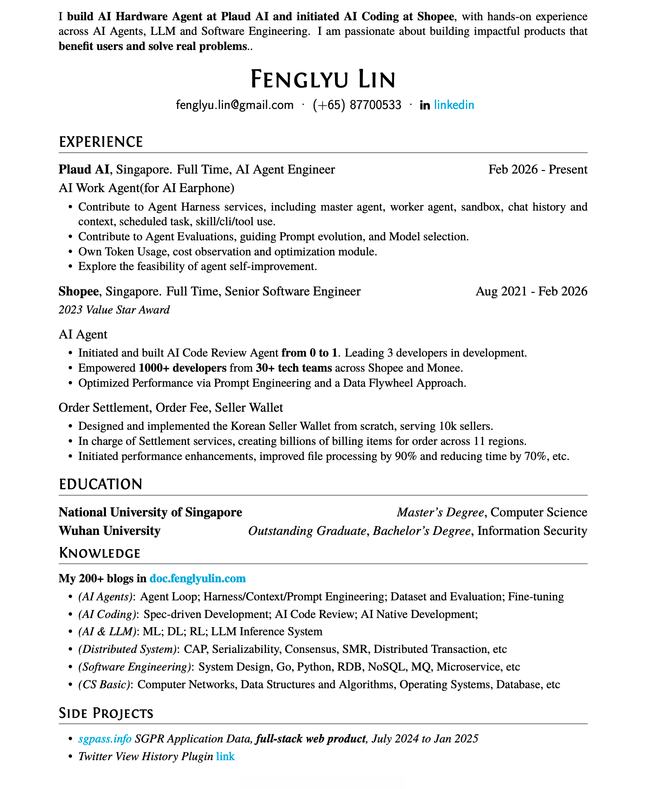
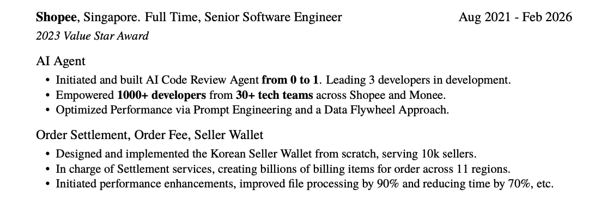
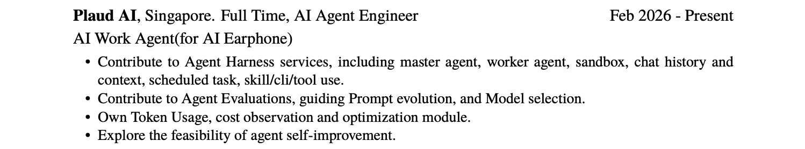
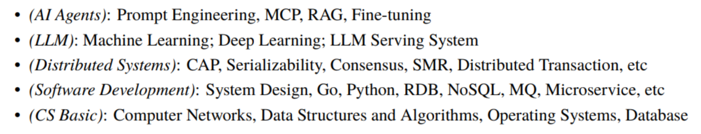
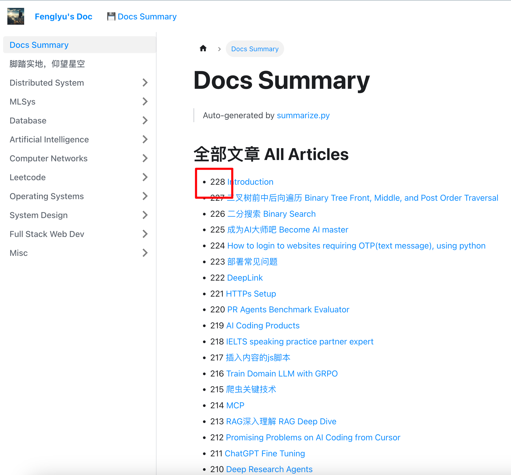
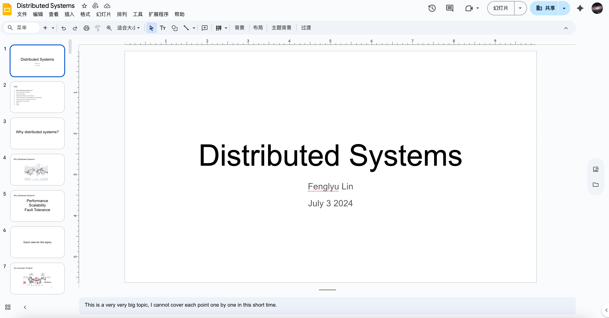

# Introduction

[Fenglyu CV](https://doc.fenglyulin.com/pdf/fenglyu_cv_20260916.pdf)

# Timeline 时间线

林峰吕 Lin Fenglyu

中国人，现居新加坡

## 教育背景

武汉大学

信息安全本科

优秀毕业生

新加坡国立大学

计算机硕士

主要选修 AI 与分布式系统相关课程

## 2021年-2026年2月：Shopee

在毕业后，我加入 Shopee SG 成为一名后端开发工程师。

主要负责 Shopee 订单清结算业务

1. 跨境订单结算系统 Settlement service
2. 跨境卖家钱包 Cross Border Seller Wallet
3. 订单计费系统 Order Fee Module

## 2025年：开始 Build AI Agent

>   -   2025 年初，AI Agent 是一个非常新颖的概念，DeepSeek/Manus 都才刚刚爆火。此前，我学习了深度学习、LLM 推理系统，正在思考如何从业务后端转型去做 AI 相关的工作。
>   -   于是，在2025年1月，我在 Shopee 内部发起了 AI for Coding 研发效率项目，公司有几十个 teams，上千个研发用过我们做的 AI Code Review Bot
>   -   从0到1，充分发挥主观能动性
>       -   设计、规划和实现需求
>       -   涉及技术：Prompt Engineering、Agent Loop、MCP 等
>   -   其中遇到的一些挑战：https://doc.fenglyulin.com/docs/system-design/Products/problems

## 2026年：Plaud AI Agent

我们 Team 主要负责新产品（AI 耳机）的 AI Work Agent 服务

- Agent Harness：Master/Work agent, Sandbox, 消息历史和上下文, 定时任务, skill/cli/tool use
- Eval：构建 Agent Evaluation pipeline，用于指导 prompt 的进化以及模型选型
- 早期探索：Agent Self-Improvement

## 技能

>   主动跟进前沿技术、做笔记，写了200多篇博客 https://doc.fenglyulin.com/docs/practise-coding-record

## 分享

>   过去在公司内部做过一些技术分享，
>
>   1. [AI Code Review](https://docs.google.com/presentation/d/1ODDjmijZP5m4rQsmEAfQSM8EOl4UlCudrSOhUbubV24)
>   2. [Distributed System](https://docs.google.com/presentation/d/1WhaGyZQZUH905QXI5QKHfKzojU1wFxcuWiNiF2pq994)

## 总结

我对 build 有价值、有影响力的产品有热情

